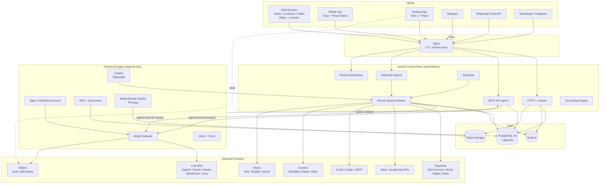
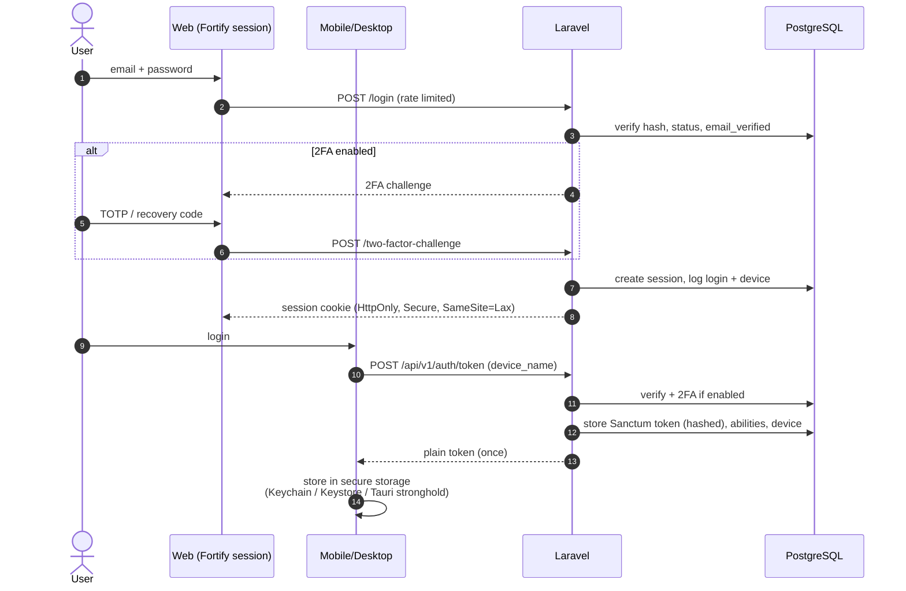
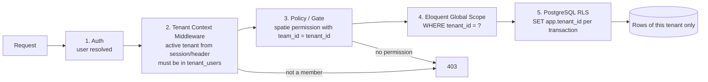
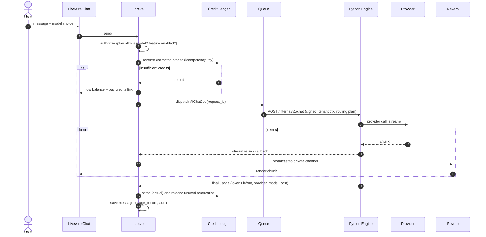
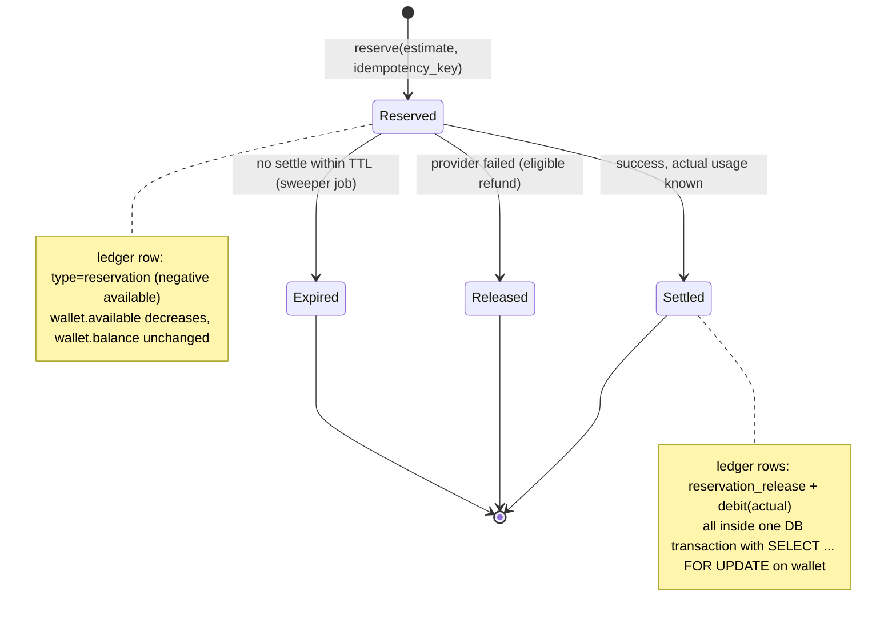
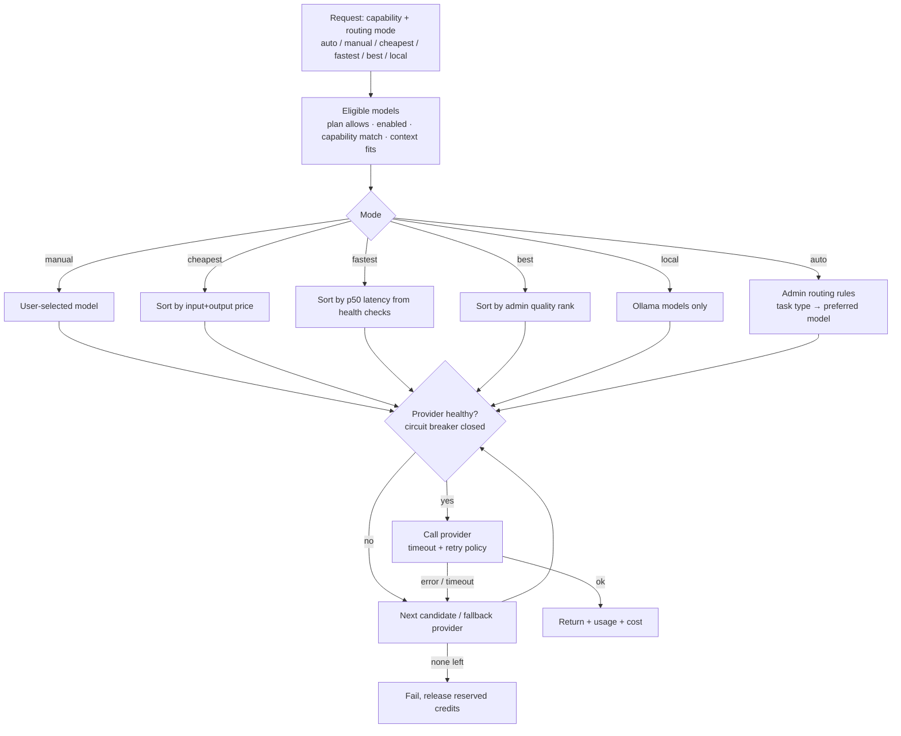
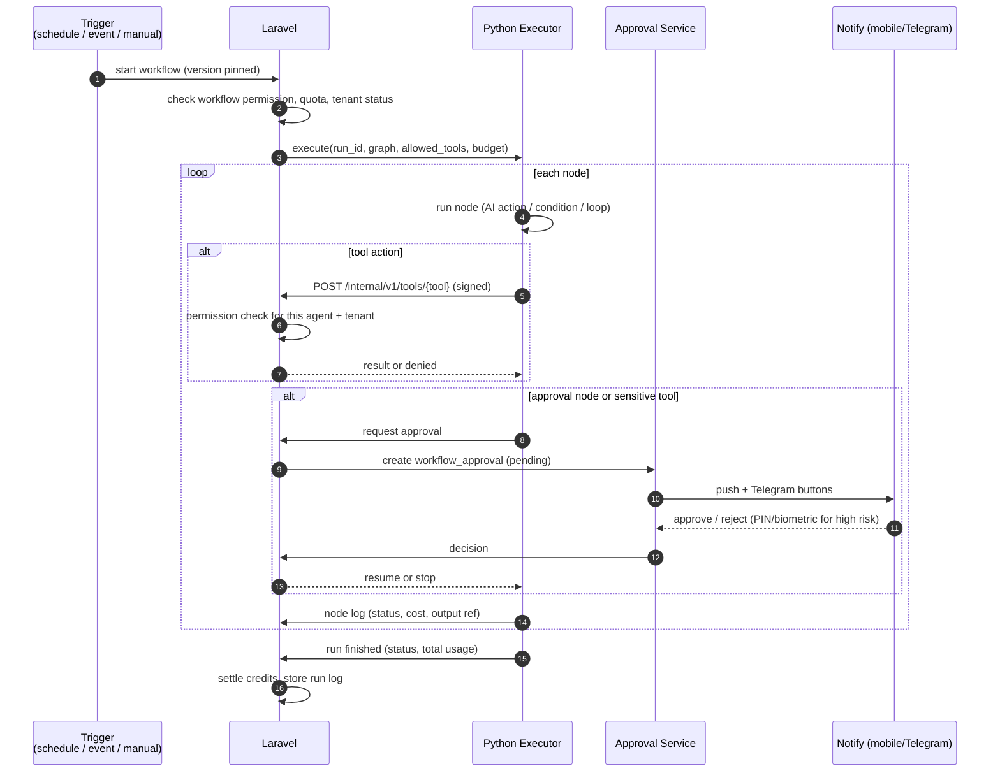
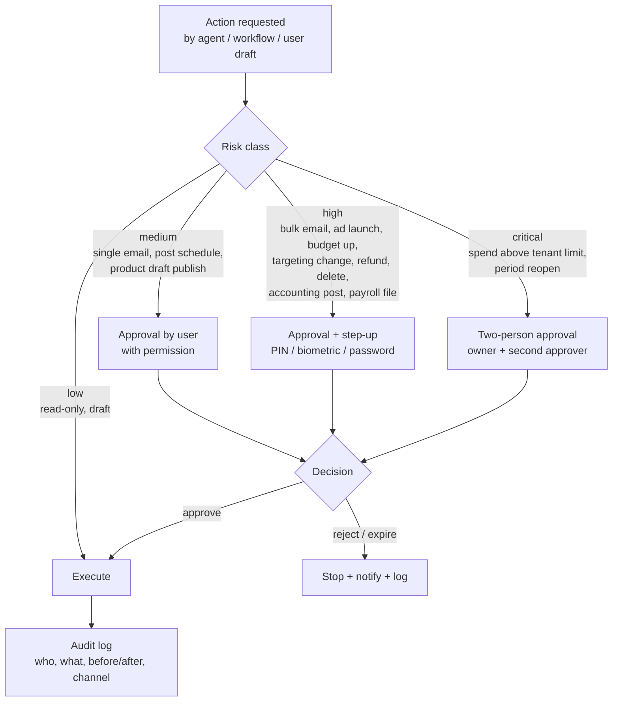
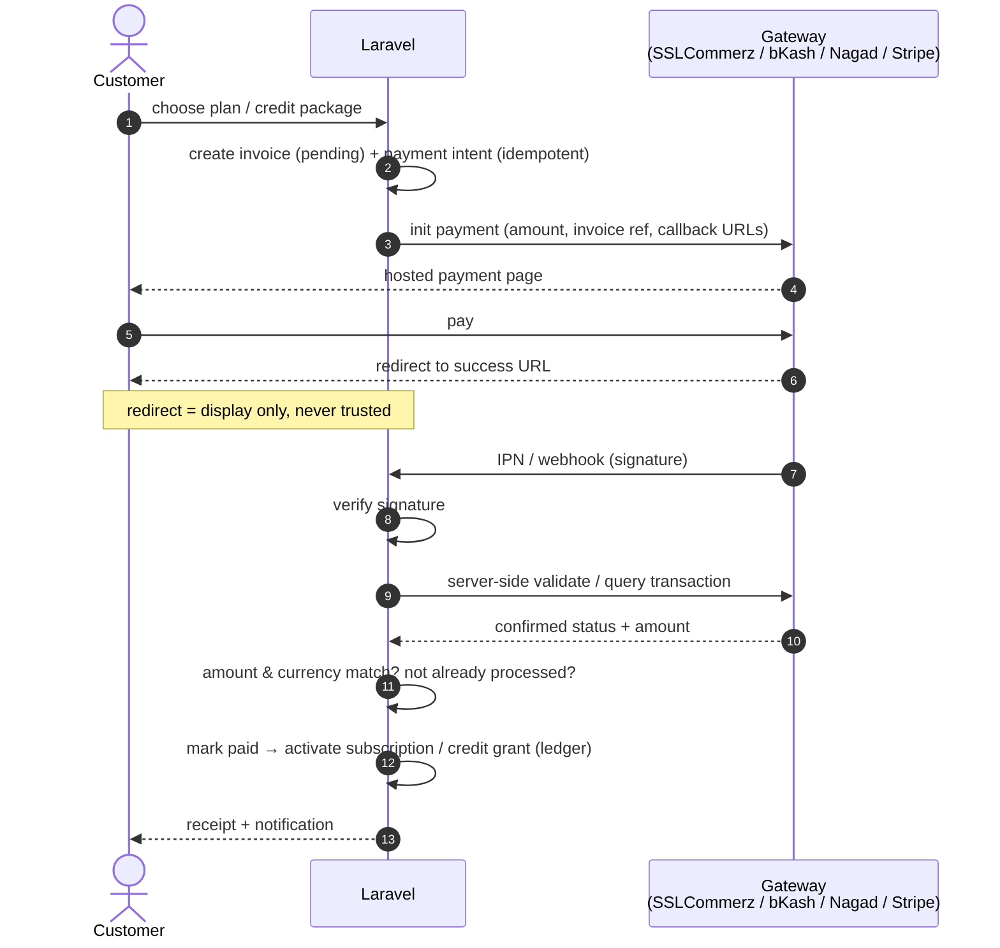

# JARVIS ONE — Architecture

**Version:** 0.1 (Phase 0) · **Status:** Proposed, awaiting owner approval

এই ডকুমেন্টে আছে: প্রযুক্তি ও সংস্করণ, সার্ভিস আর্কিটেকচার, সিস্টেম ডায়াগ্রাম ও ৮টা মূল flow ডায়াগ্রাম, Architecture Decision Records (ADR), আর ঝুঁকি ও নির্ভরতা।

---

## 1. Technology Decisions

সংস্করণগুলো ১ নভেম্বর ২০২৬ তারিখে npm, PyPI আর অফিসিয়াল রিলিজ নোট থেকে যাচাই করা। প্রতিটা ফেজ শুরুর আগে সংশ্লিষ্ট প্যাকেজ আবার যাচাই করা হবে (Development Rule ৫ ও ৬)।

### 1.1 Core Platform

| উপাদান | সিদ্ধান্ত | কারণ |
|---|---|---|
| Laravel | **13.x** | বর্তমান major (মার্চ ২০২৬); bug fix Q3 2027, security fix Q1 2028 পর্যন্ত। Laravel 14 এলে (আনুমানিক Q1 2027) আলাদা আপগ্রেড ফেজ |
| PHP | **8.4** | Laravel 13-এর ন্যূনতম 8.3; 8.4 পরিপক্ব আর সব প্রধান extension সাপোর্ট করে। কোড 8.5-compatible রাখা হবে |
| Livewire | **4.x** | জানুয়ারি ২০২৬ থেকে stable; v4.2 থেকে Laravel 13 সাপোর্ট, islands, `wire:sort` |
| Alpine.js | **3.x** | Livewire-এর সাথে bundled; client-side interaction |
| Tailwind CSS | **4.x** | Blade UI-এর জন্য, Vite দিয়ে build (শুধু asset bundling, আলাদা SPA নয়) |
| Auth (web) | **Laravel Fortify** | headless auth + 2FA (TOTP), view আমরা Blade/Livewire-এ বানাব |
| Auth (API) | **Laravel Sanctum** | mobile ও desktop-এর জন্য token, web-এর জন্য session |
| RBAC | **spatie/laravel-permission** (teams mode) | `team_id` = `tenant_id`, প্রতিটা tenant-এর রোল আলাদা |
| Queue | **Redis + Laravel Horizon** | কিউ মনিটরিং, retry, আলাদা queue ভাগ |
| Realtime | **Laravel Reverb** | চ্যাট স্ট্রিমিং, নোটিফিকেশন, লাইভ স্ট্যাটাস |
| Testing (PHP) | **Pest** | Laravel-এর ডিফল্ট টেস্ট ফ্রেমওয়ার্ক |
| Money | decimal(20,4) কলাম + `brick/money` | float কখনো নয় |

### 1.2 Data & Infrastructure

| উপাদান | সিদ্ধান্ত | কারণ |
|---|---|---|
| Database | **PostgreSQL 18** | Row-Level Security, JSONB, শক্তিশালী transaction |
| Vector | **pgvector 0.8.x** | PostgreSQL 18-এর প্যাকেজ উপলব্ধ; Laravel 13-এ native vector query (`whereVectorSimilarTo`) |
| Cache/Queue store | **Redis 8.x** | Horizon, cache, rate limit, lock |
| Object storage | S3-compatible (প্রোডাকশনে MinIO বা Cloudflare R2/Wasabi) | মিডিয়া, ডকুমেন্ট, ভিডিও, ব্যাকআপ |
| Container | Docker Engine + Compose v2 | লোকাল ও single-server প্রোডাকশন একই |
| Web server | Nginx | reverse proxy, TLS, static |
| Search (পরে) | PostgreSQL full-text প্রথমে | আলাদা search engine শুধু প্রয়োজন প্রমাণ হলে |

### 1.3 AI Engine

| উপাদান | সিদ্ধান্ত |
|---|---|
| Python | **3.13** (3.14 বের হয়েছে, কিন্তু কিছু ML লাইব্রেরি এখনো পিছিয়ে) |
| Framework | **FastAPI 0.16x** + **Pydantic 2.x** + Uvicorn |
| Async HTTP | httpx |
| Browser automation | **Playwright 1.6x** (Python) |
| Media | FFmpeg (ভিডিও এডিট ও রেন্ডার), Pillow |
| Testing | pytest + pytest-asyncio + respx (HTTP mock) |

### 1.4 Clients

| উপাদান | সিদ্ধান্ত |
|---|---|
| Desktop | **Tauri 2.x** (CLI 2.12) + React 19 + TypeScript + Vite |
| Mobile | **Expo** (লেখার সময় SDK 58, npm-এ `expo@58`) + React Native, Expo Router, EAS Build. ফেজ ১১ শুরুর সময় সর্বশেষ stable SDK নেওয়া হবে |
| Node | **24 LTS** (build tooling) |
| Shared types | `packages/shared-types` (TypeScript), OpenAPI থেকে generate |

### 1.5 Laravel AI SDK নিয়ে সিদ্ধান্ত

Laravel 13-এ একটা first-party AI SDK এসেছে। ব্লুপ্রিন্ট অনুযায়ী **AI provider কল Python engine করবে**, তাই প্রোভাইডার কলের জন্য Laravel AI SDK ব্যবহার হবে না। কারণ: এজেন্ট, RAG, ভয়েস আর ভিডিওর ভারী কাজ এক জায়গায় থাকবে, আর provider adapter দুই জায়গায় ডুপ্লিকেট হবে না। Laravel-এ শুধু pgvector query helper ব্যবহার করা যেতে পারে (RAG retrieval-এর authorization চেক Laravel-এ থাকলে)। এটা ADR-004-এ নথিভুক্ত।

---

## 2. Service Architecture

### 2.1 লজিক্যাল সার্ভিস

শুরুতে এগুলো **দুটো deployable** (Laravel monolith + Python engine) এবং কয়েকটা worker process হিসেবে চলবে। প্রয়োজনে পরে আলাদা করা যাবে। লজিক্যাল সীমানা এখনই কোডের module/namespace দিয়ে আলাদা থাকবে।

| # | লজিক্যাল সার্ভিস | কোথায় চলবে |
|---|---|---|
| 1 | SaaS Control Plane (auth, tenant, RBAC, admin) | Laravel |
| 2 | Billing & Usage Service (plan, subscription, credit ledger) | Laravel |
| 3 | Integration Service (OAuth, token, webhook) | Laravel |
| 4 | Messaging Channel Gateway (Telegram, WhatsApp, Messenger, web chat) | Laravel (webhook ingress) + queue |
| 5 | Marketing Automation (lead, CRM, email, social, ads) | Laravel + queue |
| 6 | E-commerce Service (store, inbox, order, courier) | Laravel + queue |
| 7 | Accounting Engine (double-entry, VAT, payroll) | Laravel (deterministic, AI ছাড়া) |
| 8 | AI Model Gateway (adapter, routing, fallback) | Python |
| 9 | Agent Orchestration & Workflow Executor | Python (execution) + Laravel (definition, permission) |
| 10 | RAG / Document Processing | Python |
| 11 | Voice & Vision | Python |
| 12 | Media Service (image/video generation, FFmpeg render) | Python render worker |
| 13 | Crawler (lead extraction) | Python + Playwright worker |
| 14 | Desktop/Mobile Communication Layer | Laravel API + Reverb |
| 15 | Productivity Service (calendar, tasks, reminders, meetings) | Laravel (data, integrations) + Python (transcription, summary) |
| 16 | Developer Platform & Plugin Runtime | Laravel (API keys, registry, review) + isolated plugin execution (ADR-014) |
| 17 | Desktop Local Store & Sync | Tauri app (SQLite) ↔ Laravel sync API (ADR-013) |

### 2.2 System Diagram



### 2.3 Responsibilities

**Laravel (authoritative):** authentication, authorization, tenant isolation, subscription, credits (ledger), payments, provider configuration ও credential vault, user/team management, workflow definition ও permission, approval, audit log, public REST API, সব external business integration (payment, ads, email, store, courier)।

**Python (execution only):** AI provider কল, routing execution, RAG processing, agent ও tool orchestration, vision, voice, document processing, crawler, media render।

**Python যা কখনো করবে না:**
- subscription, plan limit বা wallet balance পরিবর্তন
- নিজে থেকে কোনো external business action (ইমেইল পাঠানো, Ads বদলানো, পেমেন্ট)। এগুলো Laravel-এর approved action endpoint দিয়ে হবে
- provider credential স্থায়ীভাবে সংরক্ষণ। প্রতিটা রিকোয়েস্টে Laravel একটা short-lived, decrypted credential পাঠাবে অথবা Python Laravel থেকে on-demand নেবে, শুধু memory-তে থাকবে

---

## 3. Core Flows

### 3.1 Authentication Flow



### 3.2 Tenant Isolation Flow

প্রতিটা রিকোয়েস্টে চার স্তরে tenant যাচাই হবে (ADR-002):



- Global scope ভুলে বাদ পড়লেও **RLS** অন্য tenant-এর row ফেরত দেবে না।
- Super Admin-এর cross-tenant access শুধু নির্দিষ্ট admin route থেকে, আলাদা DB role বা RLS bypass flag দিয়ে, আর প্রতিটা access অডিট লগে যাবে।
- Queue job-এ `tenant_id` সবসময় payload-এ থাকবে আর job শুরুতে context সেট হবে।
- Python-এ পাঠানো প্রতিটা রিকোয়েস্টে signed tenant context থাকবে; Python সেটা যাচাই না করে কাজ করবে না।

### 3.3 AI Request Flow



### 3.4 Credit Deduction Flow (reserve → settle)



নিয়ম:
- ledger **append-only**, কোনো row update বা delete নয়। ভুল ঠিক করতে reversal/adjustment row।
- `credit_transactions.idempotency_key` unique, তাই একই রিকোয়েস্ট দুবার কাটবে না।
- wallet-এর balance ledger-এর যোগফলের cache। রাতের reconciliation job দুটো মিলিয়ে দেখবে আর অমিল হলে অ্যালার্ট দেবে।

### 3.5 Provider Routing Flow



Routing plan (eligible list, order) **Laravel তৈরি করে** Python-এ পাঠায়। Python শুধু সেই তালিকার মধ্যে fallback করতে পারে, তালিকার বাইরে যেতে পারে না।

### 3.6 Workflow Execution Flow



Limit: প্রতিটা run-এর max execution time, max nodes, max loop iterations, আর credit budget থাকবে। Agent কখনো নিজের permission বাড়াতে পারবে না।

### 3.7 Approval Flow



Risk class টেবিল কনফিগারযোগ্য (tenant নিজের policy কড়া করতে পারবে, কিন্তু সিস্টেম ন্যূনতমের নিচে নামাতে পারবে না)।

### 3.8 Payment Flow



---

## 4. Code Organization

### 4.1 Monorepo

```text
jarvis-one/
├── apps/
│   ├── laravel/        # Admin + Customer + Public (Blade/Livewire) + REST API
│   ├── ai-engine/      # Python FastAPI internal service + workers
│   ├── desktop/        # Tauri 2 (src/ React, src-tauri/ Rust)
│   └── mobile/         # Expo React Native
├── packages/
│   ├── shared-types/   # TS types generated from OpenAPI
│   ├── api-client/     # TS client for mobile + desktop
│   └── documentation/
├── infrastructure/
│   ├── docker/         # Dockerfiles per service
│   ├── nginx/
│   └── scripts/        # setup, deploy, backup, restore, rollback
├── docs/diagrams/
├── docker-compose.yml
└── *.md
```

### 4.2 Laravel Modules

Laravel-এর ভেতরে domain-ভিত্তিক module (`app/Domain/<Module>`), প্রতিটায় Models, Actions, Policies, Events, Jobs:

`Identity`, `Tenancy`, `Access`, `Admin`, `Billing`, `Credits`, `AiGateway` (config ও routing plan), `Conversations`, `Memory`, `Knowledge`, `Agents`, `Workflows`, `Approvals`, `Messaging`, `Leads`, `Crm`, `Outreach`, `Proposals`, `Creative`, `Social`, `Ads` (Meta, Google), `Seo`, `Commerce`, `Inbox`, `Delivery`, `Accounting`, `Tax`, `Payroll`, `Audit`, `Integrations`, `Notifications`, `Support`, `WhiteLabel`, `System`

UI: `resources/views/{admin,customer,public}` আর Livewire কম্পোনেন্ট `app/Livewire/{Admin,Customer,Public}`।

### 4.3 Workflow Builder (Livewire-এর মধ্যে)

ব্লুপ্রিন্ট আলাদা React web app নিষেধ করে। তাই ভিজুয়াল ক্যানভাস হবে Livewire পেজের ভেতরে Alpine.js + একটা framework-independent vanilla JS graph লাইব্রেরি দিয়ে (প্রার্থী: Drawflow বা নিজস্ব SVG ক্যানভাস)। গ্রাফ JSON হিসেবে Livewire-এ sync হবে, validation সার্ভারে। চূড়ান্ত লাইব্রেরি ফেজ ২১-এর শুরুতে license ও maintenance যাচাই করে বাছাই হবে। একই পদ্ধতি Video Editor টাইমলাইনের জন্য (ফেজ ২২.২)।

---

## 5. Architecture Decision Records

| ADR | সিদ্ধান্ত | বিকল্প | কারণ |
|---|---|---|---|
| ADR-001 | Web UI = Laravel Blade + Livewire 4, কোনো আলাদা React web app নয় | Inertia/React SPA | ব্লুপ্রিন্টের non-negotiable নিয়ম; এক কোডবেস, সার্ভার-সাইড authorization সহজ |
| ADR-002 | **Single database, shared schema**, প্রতিটা tenant-owned টেবিলে `tenant_id` + Eloquent global scope + **PostgreSQL Row-Level Security** | database-per-tenant (stancl/tenancy multi-db), schema-per-tenant | হাজার হাজার Free tenant-এর জন্য DB-per-tenant ব্যয়বহুল ও মাইগ্রেশন জটিল; RLS দ্বিতীয় প্রতিরক্ষা দেয়। Enterprise-এর dedicated deployment আলাদা instance হিসেবে (ফেজ ২৭) |
| ADR-003 | Tenancy নিজস্ব হালকা layer (middleware + scope + RLS), তৃতীয় পক্ষের tenancy প্যাকেজ নয় | stancl/tenancy single-db mode | RLS integration আর queue/Python context propagation-এ পূর্ণ নিয়ন্ত্রণ; প্যাকেজের সুবিধা সীমিত। ফেজ ২-এ আবার মূল্যায়ন করে চূড়ান্ত |
| ADR-004 | AI provider কল শুধু Python engine-এ; Laravel routing plan বানায় | Laravel AI SDK দিয়ে সরাসরি কল | এজেন্ট, RAG, voice, media এক জায়গায়; adapter ডুপ্লিকেশন এড়ানো |
| ADR-005 | Laravel ↔ Python: private network-এ HMAC-signed রিকোয়েস্ট + short-lived JWT (60s), replay রোধে nonce + timestamp | mTLS, API key | সহজ, শক্তিশালী; প্রোডাকশনে enterprise deployment-এ mTLS যোগ করা যাবে |
| ADR-006 | Credit ledger append-only, reserve → settle মডেল, idempotency key | সরাসরি balance কমানো | race condition আর ডাবল-চার্জ রোধ, অডিটযোগ্য |
| ADR-007 | Primary key: **ULID** (string(26)) পাবলিক-ফেসিং টেবিলে; লেজার ও লগে bigint identity | UUID v4 | sortable, index-বান্ধব, URL-এ নিরাপদ (enumerable নয়) |
| ADR-008 | Accounting হিসাব deterministic PHP engine-এ; AI শুধু খসড়া/ব্যাখ্যা | AI দিয়ে হিসাব | নির্ভুলতা বাধ্যতামূলক |
| ADR-009 | Credential vault: Laravel encrypted cast (AES-256-GCM via APP_KEY) + আলাদা `VAULT_KEY` দিয়ে envelope encryption; key rotation কমান্ড | শুধু APP_KEY | APP_KEY ফাঁস হলেও vault আলাদা রক্ষা পায়; ভবিষ্যতে KMS যোগযোগ্য |
| ADR-010 | Official API only (Meta, Google Ads, WhatsApp Cloud API, Telegram Bot API); কোনো unofficial automation নয় | WhatsApp Web লাইব্রেরি | ব্যান ঝুঁকি, নীতিভঙ্গ |
| ADR-011 | VPS-only deployment (cPanel shared hosting সাপোর্টেড নয়) | cPanel | PostgreSQL+pgvector, Redis, long-running workers, Python, FFmpeg লাগে |
| ADR-012 | Desktop/Mobile শুধু public REST API ব্যবহার করবে (কোনো সরাসরি DB/Python access নয়) | — | একক authorization পয়েন্ট |
| ADR-013 | Desktop-এ লোকাল **SQLite** (অফলাইন মেমোরি, চ্যাট, টাস্ক কিউ, ফাইল ইনডেক্স); ক্লাউডের সাথে সিঙ্ক `updated_at` + ULID ভিত্তিক, last-writer-wins আর মুছে ফেলার জন্য tombstone; ব্যক্তিগত লোকাল ফাইল ইনডেক্স ক্লাউডে যাবে না | শুধু ক্লাউড | Free প্ল্যানে লোকাল Ollama দিয়ে অফলাইন ব্যবহার; প্রাইভেসি |
| ADR-014 | প্লাগইন হবে **ঘোষিত পারমিশন ম্যানিফেস্টসহ**, অনুমোদিত API-র মাধ্যমে চলবে (সরাসরি DB বা সার্ভারে arbitrary কোড নয়); প্রকাশের আগে অ্যাডমিন রিভিউ; সার্ভার-সাইড প্লাগইন আলাদা স্যান্ডবক্সে | মুক্ত PHP প্লাগইন | তৃতীয় পক্ষের কোড থেকে tenant ডাটা রক্ষা |
| ADR-015 | প্রোডাক্টের নাম, লোগো আর ব্র্যান্ড সব কনফিগ (`config/brand.php` + অ্যাডমিন branding) থেকে; কোডে কোথাও নাম hardcode নয় | — | নাম বদলালে (R14) এক জায়গায় পরিবর্তন; হোয়াইট-লেবেলেও লাগবে |

---

## 6. Hosting Requirements

| পরিবেশ | ন্যূনতম | প্রস্তাবিত |
|---|---|---|
| ডেভেলপমেন্ট | 4 vCPU, 8 GB RAM, Docker | 8 GB+ |
| Single-server প্রোডাকশন (লঞ্চ) | 4 vCPU, 8 GB RAM, 160 GB NVMe | 8 vCPU, 16 GB RAM (ভিডিও রেন্ডার ও Playwright থাকলে) |
| স্কেল-আপ | আলাদা DB সার্ভার, আলাদা render/crawler worker, managed Redis | — |
| GPU | প্রয়োজন নেই (cloud provider ব্যবহার); লোকাল ইমেজ/ভিডিও মডেল চাইলে আলাদা GPU নোড | — |

OS: Ubuntu 24.04 LTS। বিস্তারিত [`DEPLOYMENT_GUIDE.md`](DEPLOYMENT_GUIDE.md)।

### Queue Architecture

| Queue | কাজ | প্রায়োরিটি |
|---|---|---|
| `critical` | পেমেন্ট webhook, approval decision, emergency stop | সর্বোচ্চ |
| `ai` | চ্যাট, এজেন্ট স্টেপ | উচ্চ |
| `messaging` | Telegram/WhatsApp/Messenger ইনবাউন্ড ও আউটবাউন্ড | উচ্চ |
| `default` | সাধারণ | মাঝারি |
| `outreach` | ইমেইল পাঠানো (rate-limited) | মাঝারি |
| `integrations` | store sync, ads insights, courier | মাঝারি |
| `documents` | RAG ingestion, OCR | নিম্ন |
| `crawl` | লিড এক্সট্র্যাকশন | নিম্ন |
| `render` | ভিডিও রেন্ডার (আলাদা worker) | নিম্ন |
| `reports` | রিপোর্ট, reconciliation | নিম্ন |

### Storage & Backup Strategy

- Object storage-এ path: `tenants/{tenant_id}/{module}/{ulid}.{ext}`, প্রাইভেট bucket, signed URL (স্বল্প মেয়াদ)।
- PostgreSQL: রাতে full dump + WAL archiving (point-in-time recovery), এনক্রিপ্টেড, অফসাইট কপি; ৭ দৈনিক, ৪ সাপ্তাহিক, ১২ মাসিক রিটেনশন।
- প্রতি মাসে restore drill (ফেজ ২৯-এ স্ক্রিপ্ট)।

---

## 7. Risks & Dependencies

| # | ঝুঁকি / নির্ভরতা | প্রভাব | প্রশমন |
|---|---|---|---|
| R1 | প্রকল্পের বিশাল পরিধি | সময় ও মানের ঝুঁকি | কঠোর ফেজ গেট, মাইলফলকভিত্তিক MVP, sub-phase |
| R2 | Meta App Review (Messenger, Instagram, Ads, WhatsApp) আর Business Verification | ফেজ ১৩, ২৩, ২৪.১ লাইভ হতে দেরি | ফেজ ১০-এর আশেপাশেই আবেদন শুরু; mock দিয়ে টেস্ট |
| R3 | Google Ads Developer Token Basic Access | ফেজ ২৪.২ লাইভে দেরি | আগেভাগে আবেদন, টেস্ট অ্যাকাউন্টে ডেভেলপমেন্ট |
| R4 | bKash/Nagad merchant API অ্যাক্সেস | ফেজ ১০ | sandbox দিয়ে ডেভেলপমেন্ট, SSLCommerz আগে |
| R5 | AI provider খরচ ও মূল্য পরিবর্তন | মার্জিন | admin-editable pricing, reservation, spending limit |
| R6 | Bangladesh VAT/Tax নিয়ম প্রতি বাজেটে বদলায় | ভুল হিসাব | versioned, effective-dated rules; পেশাদার রিভিউ |
| R7 | WhatsApp cold outreach নীতিগতভাবে নিষিদ্ধ | ফিচার সীমাবদ্ধ | ইমেইল-প্রথম, opt-in পরে WhatsApp (ডিজাইনে অন্তর্ভুক্ত) |
| R8 | Tauri Windows build ও code signing | ফেজ ২৫ | Windows build স্ক্রিপ্ট, code-signing সার্টিফিকেট owner কিনবেন |
| R9 | iOS (Apple Developer অ্যাকাউন্ট) | মোবাইল | Android-first |
| R10 | ভিডিও রেন্ডার CPU চাপ | সার্ভার লোড | আলাদা render queue/worker, plan-ভিত্তিক মিনিট সীমা, ডেস্কটপে লোকাল রেন্ডার |
| R11 | Crawler-এর আইনি ঝুঁকি | অভিযোগ | robots.txt, rate limit, শুধু public তথ্য, source রেকর্ড |
| R12 | Livewire-এ জটিল ক্যানভাস (workflow, video timeline) | UX জটিলতা | Alpine + vanilla JS লাইব্রেরি, আগে প্রোটোটাইপ |
| R13 | এই ডেভেলপমেন্ট পরিবেশে Docker daemon ও কিছু রেজিস্ট্রি অ্যাক্সেস সীমিত | ফেজ ১-এ Docker image টেস্ট সীমিত | Compose কনফিগ static validate; আসল `docker compose up` টেস্ট owner-এর মেশিন/VPS-এ, ম্যানুয়াল টেস্ট হিসেবে চিহ্নিত |
| R14 | "JARVIS" নাম Marvel (Disney)-এর চরিত্র; Iron Man-ধাঁচের ডিজাইন বা অবতারে ট্রেডমার্ক/কপিরাইট ঝুঁকি | নাম বদলাতে বাধ্য হওয়া, আইনি নোটিশ | লঞ্চের আগে আইনি যাচাই, মৌলিক "ফিউচারিস্টিক AI" ডিজাইন ও মৌলিক অবতার/ভয়েস, নাম কনফিগযোগ্য (ADR-015) |
| R15 | Face authentication ও ক্যামেরা = বায়োমেট্রিক ডাটা | প্রাইভেসি ও আইনি ঝুঁকি | ঐচ্ছিক, শুধু ডিভাইসে লোকাল, স্পষ্ট সম্মতি, ক্লাউডে বায়োমেট্রিক টেমপ্লেট নয় |
| R16 | তৃতীয় পক্ষের প্লাগইন | ডাটা ফাঁস, ম্যালওয়্যার | পারমিশন ম্যানিফেস্ট, রিভিউ, স্যান্ডবক্স (ADR-014) |

### External Credentials (কখন লাগবে)

| ফেজ | Credential |
|---|---|
| ৪, ৬ | কমপক্ষে একটা LLM API key (যেমন OpenAI বা Gemini), অথবা Ollama সার্ভার |
| ৭ | Telegram Bot token (BotFather) |
| ৯ | Gmail/Google Cloud OAuth client, Microsoft Entra app, অথবা SMTP |
| ১০ | SSLCommerz, bKash, Nagad sandbox/merchant; Stripe (যদি থাকে) |
| ১১ | Firebase (FCM) push, Expo/EAS অ্যাকাউন্ট |
| ১২ | Shopify Partner app / WooCommerce test store |
| ১৩ | Meta App (Messenger, Instagram), WhatsApp Business Account + নম্বর |
| ১৯.২ | Google Calendar ও Microsoft Graph OAuth, Slack app, Discord bot |
| ১৪ | Steadfast, Pathao, RedX merchant API |
| ২২ | ইমেজ/ভিডিও provider key |
| ২৩, ২৪.১ | Meta App Review অনুমোদন |
| ২৪.২ | Google Ads MCC + Developer Token + OAuth client |
| ২৫ | Windows code-signing সার্টিফিকেট |
| ২৯ | VPS, ডোমেইন, DNS, object storage |
