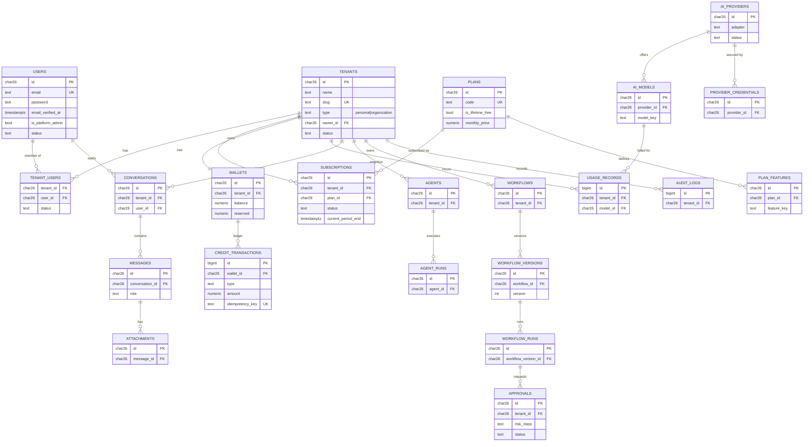

# JARVIS ONE — Database Schema

**Version:** 0.1 (Phase 0) · **Engine:** PostgreSQL 18 + pgvector · **Status:** Logical design, migrations তৈরি হবে সংশ্লিষ্ট ফেজে

---

## 1. Global Conventions

| বিষয় | নিয়ম |
|---|---|
| Primary key | পাবলিক-ফেসিং entity: `id char(26)` ULID। উচ্চ-ভলিউম লগ ও লেজার: `id bigint generated always as identity` + `ulid` কলাম যেখানে বাইরে দেখাতে হয় |
| Tenant scoping | প্রতিটা tenant-owned টেবিলে `tenant_id char(26) not null references tenants(id)`, index-এর প্রথম কলাম `tenant_id` |
| RLS | tenant-owned টেবিলে `ENABLE ROW LEVEL SECURITY` + policy `tenant_id = current_setting('app.tenant_id')`; admin context-এ `app.bypass_rls = on` (শুধু admin DB role) |
| Timestamps | `created_at`, `updated_at` `timestamptz` (UTC); ডিসপ্লেতে ইউজারের timezone (ডিফল্ট Asia/Dhaka) |
| Soft delete | শুধু যেখানে ব্যবসায়িকভাবে যুক্তিযুক্ত (users, tenants, agents, workflows, leads, products, documents)। লেজার, অডিট, অ্যাকাউন্টিং posted entry-তে কখনো নয় |
| Money | `numeric(20,4)` + `currency char(3)`। Credits: `numeric(20,4)` |
| Enum | PostgreSQL `text` + CHECK constraint (মাইগ্রেশন সহজ রাখতে native enum নয়) |
| JSON | `jsonb`, যেখানে schema নমনীয় (provider config, node config, metadata) |
| Encryption | secret কলাম (`*_encrypted`) অ্যাপ-লেভেলে envelope-encrypted, `bytea`/`text` |
| Append-only | `credit_transactions`, `audit_logs`, `journal_lines` (posted), `usage_records`: অ্যাপ লেভেলে update/delete নিষিদ্ধ + DB trigger দিয়ে UPDATE/DELETE ব্লক |
| Naming | snake_case, বহুবচন টেবিল নাম, FK: `<entity>_id` |

**Retention ডিফল্ট** (admin-কনফিগারযোগ্য): AI request লগ ৯০ দিন, webhook লগ ৩০ দিন, অডিট লগ ৭ বছর (অ্যাকাউন্টিং আইনি প্রয়োজনে), কথোপকথন ইউজার-নিয়ন্ত্রিত।

---

## 2. Core ER Diagram

---

## 3. Module Tables

চিহ্ন: **T** = tenant-owned (tenant_id + RLS), **G** = global/platform, **A** = append-only

### 3.1 Identity (ফেজ ২)

| টেবিল | ধরন | মূল কলাম |
|---|---|---|
| `users` | G | id, name, email (unique, citext), password, email_verified_at, locale, timezone, is_platform_admin, status (active/suspended/pending), last_login_at, deleted_at |
| `user_profiles` | G | user_id, avatar_path, phone, job_title, bio |
| `user_preferences` | G | user_id, key, value jsonb |
| `two_factor_settings` | G | user_id, secret_encrypted, recovery_codes_encrypted, confirmed_at |
| `sessions` | G | Laravel database session (id, user_id, ip, user_agent, payload, last_activity) |
| `devices` | G | id, user_id, name, platform (web/android/ios/windows), fingerprint_hash, push_token_encrypted, last_seen_at, revoked_at |
| `personal_access_tokens` | G | Sanctum (tokenable, name, token hash, abilities, last_used_at, expires_at) + device_id |
| `login_logs` | G·A | user_id, ip, user_agent, result (success/failed/2fa_failed), created_at |

### 3.2 Multi-Tenancy (ফেজ ২)

| টেবিল | ধরন | মূল কলাম |
|---|---|---|
| `tenants` | G | id, name, slug (unique), type (personal/organization), owner_id, status, locale, timezone, currency, reseller_id null, deleted_at |
| `tenant_users` | G | tenant_id, user_id, status (active/invited/removed), joined_at · unique(tenant_id, user_id) |
| `tenant_settings` | T | tenant_id, key, value jsonb · unique(tenant_id, key) |
| `tenant_domains` | T | tenant_id, domain (unique), verified_at, type (custom/subdomain) |
| `invitations` | T | tenant_id, email, role, token_hash, invited_by, expires_at, accepted_at |

### 3.3 RBAC (ফেজ ২–৩) — spatie/laravel-permission, teams mode

| টেবিল | মূল কলাম |
|---|---|
| `roles` | id, team_id (null = platform role), name, guard_name, is_system |
| `permissions` | id, name (যেমন `users.manage`, `ads.approve`), guard_name, group |
| `role_has_permissions` | role_id, permission_id |
| `model_has_roles` | role_id, model_type, model_id, team_id |
| `model_has_permissions` | permission_id, model_type, model_id, team_id |

Platform role (team_id null): Super Admin, System Admin, Support Admin, Finance Admin, Provider Manager, Read-Only Auditor। Tenant role: Owner, Admin, Manager, Member, Auditor (+ custom)।

### 3.4 Plans, Subscriptions, Billing (ফেজ ৩, ১০)

| টেবিল | ধরন | মূল কলাম |
|---|---|---|
| `plans` | G | id, code (free/pro/ultra/business/enterprise), name, description, is_lifetime_free, is_public, monthly_price, yearly_price, currency, trial_days, included_credits, monthly_credit_refill, sort, status |
| `plan_prices` | G | plan_id, currency (USD/BDT), interval, amount · একাধিক মুদ্রা |
| `features` | G | key (unique, যেমন `module.accounting`, `limit.agents`), category, type (boolean/limit/meter), description |
| `plan_features` | G | plan_id, feature_key, enabled, limit_value numeric null |
| `tenant_feature_overrides` | T | tenant_id, feature_key, enabled, limit_value, reason, set_by |
| `subscriptions` | T | id, tenant_id, plan_id, status (active/trialing/past_due/grace/cancelled/expired), interval, current_period_start/end, cancel_at, grace_ends_at, gateway, gateway_ref |
| `invoices` | T | id, tenant_id, number (unique), subscription_id null, subtotal, tax, total, currency, status (draft/open/paid/void/refunded), due_at, paid_at |
| `invoice_items` | T | invoice_id, description, quantity, unit_amount, amount, type (plan/credits/addon) |
| `payments` | T | id, tenant_id, invoice_id, gateway, gateway_txn_id (unique per gateway), amount, currency, status, verified_at, raw_payload jsonb (sanitized) |
| `refunds` | T | payment_id, amount, reason, status, processed_by |
| `coupons` | G | code (unique), type (percent/fixed/credits), value, max_redemptions, expires_at, plan_scope |
| `coupon_redemptions` | T | coupon_id, tenant_id, invoice_id |
| `payment_gateways` | G | code, name, enabled, mode (sandbox/live), credentials_encrypted, callback_config jsonb |

### 3.5 Credits & Usage (ফেজ ৫)

| টেবিল | ধরন | মূল কলাম |
|---|---|---|
| `wallets` | T | id, tenant_id (unique), balance, reserved, currency='CREDIT', low_balance_threshold, spending_limit_monthly, version (optimistic) |
| `credit_transactions` | T·A | id bigint, ulid, wallet_id, tenant_id, type (grant_free/grant_plan/purchase/bonus/reservation/reservation_release/debit/refund/adjustment/expiry), amount (± signed), balance_after, reference_type, reference_id, idempotency_key (unique), expires_at null, created_by, note |
| `credit_packages` | G | name, credits, price, currency, bonus_credits, status |
| `usage_records` | T·A | id bigint, tenant_id, user_id, request_id, source (chat/agent/workflow/image/video/voice/email/storage/render), provider_id, model_id, input_tokens, output_tokens, units, unit_type, provider_cost, provider_currency, credits_charged, created_at |
| `provider_cost_records` | G·A | provider_id, period, amount, currency, source (computed/invoice), notes |

### 3.6 AI Providers & Models (ফেজ ৪)

| টেবিল | ধরন | মূল কলাম |
|---|---|---|
| `ai_providers` | G | id, name, adapter (openai/anthropic/gemini/openrouter/groq/ollama/openai_compatible/custom_rest), type (llm/voice/image/video/embedding), base_url, auth_type, timeout_ms, retry_policy jsonb, rate_limits jsonb, priority, fallback_provider_id, status |
| `provider_credentials` | G | provider_id, label, secret_encrypted, key_version, last_rotated_at, status |
| `ai_models` | G | id, provider_id, model_key, display_name, category, is_local, is_free_tier, context_window, max_output, quality_rank, status, deprecated_at |
| `model_capabilities` | G | model_id, capability (text/vision/audio_in/audio_out/image_gen/video_gen/embedding/tool_use/json_mode) |
| `model_pricing` | G | model_id, input_per_1m, output_per_1m, per_request, per_image, per_second, currency, credit_multiplier, effective_from |
| `model_access_rules` | G | model_id, plan_id, allowed |
| `routing_rules` | G | task_type, mode, preferred_model_ids jsonb, conditions jsonb, priority |
| `provider_health_checks` | G·A | provider_id, model_id, status, latency_ms, error, checked_at |
| `tenant_model_preferences` | T | tenant_id, default_model_id, routing_mode |

### 3.7 Conversations (ফেজ ৬)

| টেবিল | ধরন | মূল কলাম |
|---|---|---|
| `conversations` | T | id, tenant_id, user_id, title, folder_id, model_id, **mode (general/code; তৈরির সময় ঠিক, পরে বদলানো যায় না — ট্রিগার)**, **character_id (একই ওয়ার্কস্পেসের চরিত্র; তৈরির সময় ঠিক, অপরিবর্তনীয়)**, system_prompt, channel (web/mobile/desktop/telegram/whatsapp), pinned, archived_at, deleted_at |
| `conversation_folders` | T | tenant_id, user_id, name |
| `messages` | T | id, tenant_id, conversation_id, role (user/assistant/system/tool), content, model_id, status (streaming/complete/error/stopped), usage_record_id, created_at |
| `attachments` | T | id, tenant_id, message_id, disk, path, mime, size, sha256, scan_status |
| `message_tool_calls` | T | message_id, tool, arguments jsonb, result_ref, status, approval_id |

### 3.8 Messaging Channels (ফেজ ৭, ১৩)

| টেবিল | ধরন | মূল কলাম |
|---|---|---|
| `channel_accounts` | T/G | id, tenant_id null (null = platform bot), channel (telegram/whatsapp/messenger/instagram/webchat), external_id, credentials_encrypted, status, webhook_secret_encrypted |
| `channel_links` | T | tenant_id, user_id, channel, external_user_id, verified_at · ইউজারের Telegram/WhatsApp লিংক |
| `channel_link_codes` | T | user_id, code_hash, expires_at |
| `channel_messages` | T | id, tenant_id, channel_account_id, direction, external_message_id (unique per account), contact_id, conversation_ref, type, content, media_path, status, created_at |
| `channel_templates` | T | channel_account_id, name, category (utility/marketing/authentication), language, status, components jsonb |
| `push_devices` | G | device_id, provider (fcm/expo), token_encrypted |

### 3.9 Memory & Knowledge (ফেজ ১৯)

| টেবিল | ধরন | মূল কলাম |
|---|---|---|
| `memories` | T | id, tenant_id, user_id, scope (personal/business/project), content, source_message_id, consent, embedding vector(dim), deleted_at |
| `knowledge_bases` | T | id, tenant_id, name, embedding_model_id, access (private/team) |
| `documents` | T | id, tenant_id, knowledge_base_id, source_type (upload/url/note), title, path, url, mime, status (queued/processing/ready/failed), error, chunk_count |
| `document_chunks` | T | id, tenant_id, document_id, ordinal, content, tokens, metadata jsonb, embedding vector(dim) · HNSW index (vector_cosine_ops) |
| `retrieval_logs` | T·A | tenant_id, query_hash, document_ids, created_at |

Embedding dimension মডেলভেদে আলাদা, তাই প্রতি knowledge base একটাই embedding model; মডেল বদলালে re-embed job।

### 3.10 Agents & Workflows (ফেজ ২১)

| টেবিল | ধরন | মূল কলাম |
|---|---|---|
| `agent_templates` | G | key, department, name, description, instructions, default_tools jsonb, default_model_id |
| `agents` | T | id, tenant_id, template_id, name, department, instructions, model_id, status (active/paused), credit_quota_monthly, deleted_at |
| `tools` | G | key (যেমন `email.draft`, `ads.meta.pause`), risk_class, description, input_schema jsonb |
| `agent_tools` | T | agent_id, tool_key, config jsonb |
| `agent_permissions` | T | agent_id, permission |
| `agent_runs` | T | id, tenant_id, agent_id, trigger, status, started_at, finished_at, credits_used, error |
| `agent_tasks` / `agent_logs` | T·A | run_id, step, type, payload, created_at |
| `workflows` | T | id, tenant_id, name, status, active_version_id, deleted_at |
| `workflow_versions` | T | id, workflow_id, version, graph jsonb (nodes + edges), published_at, published_by |
| `workflow_triggers` | T | workflow_id, type (schedule/event/manual/webhook), config jsonb, next_run_at |
| `workflow_runs` | T | id, tenant_id, workflow_version_id, trigger, status, started_at, finished_at, credits_used, budget |
| `workflow_run_logs` | T·A | run_id, node_id, status, input_ref, output_ref, error, cost |
| `approvals` | T | id, tenant_id, subject_type, subject_id, action, risk_class, payload jsonb, requested_by (user/agent), status (pending/approved/rejected/expired), decided_by, decided_via (web/mobile/telegram), step_up_method, expires_at |

ফেজ ০-এর সিদ্ধান্ত: ব্লুপ্রিন্টের `workflow_nodes`/`workflow_edges` আলাদা টেবিলের বদলে **versioned graph jsonb** (`workflow_versions.graph`)। কারণ: প্রতিটা version অপরিবর্তনীয় snapshot, পুরো গ্রাফ একসাথে লোড হয়, আর পুরনো run সবসময় তার নিজের version দেখায়। প্রয়োজন হলে রিপোর্টিংয়ের জন্য materialized view।

### 3.11 Marketing (ফেজ ৮, ৯, ২৩, ২৪)

| টেবিল | ধরন | মূল কলাম |
|---|---|---|
| `lead_research_jobs` | T | id, tenant_id, input_type (url/csv), status, total, processed, failed |
| `companies` | T | id, tenant_id, name, domain, website, industry, size, address, analysis jsonb (service gaps), score, deleted_at |
| `contacts` | T | id, tenant_id, company_id, name, email, email_status (unverified/syntax_ok/mx_ok/bounced/unsubscribed), phone_e164, role, source_url, collected_at |
| `leads` | T | id, tenant_id, company_id, contact_id, stage, score, owner_id, source, next_follow_up_at, tags, custom_fields jsonb, deleted_at |
| `lead_sources` | T | name, type |
| `lead_activities` | T·A | lead_id, type (note/email/call/task/stage_change), payload, user_id |
| `crm_tasks` | T | lead_id, title, due_at, assignee_id, done_at |
| `portfolio_items` | T | tenant_id, title, industry_tags, url, media, description |
| `brand_kits` | T | tenant_id, name, logo_path, colors jsonb, fonts, tone, contact jsonb, is_default |
| `proposal_templates` | T/G | tenant_id null, type, language, body |
| `proposals` | T | id, tenant_id, lead_id, template_id, data jsonb, pdf_path, status |
| `email_accounts` | T | tenant_id, provider (gmail/graph/smtp), address, credentials_encrypted, daily_limit, warmup_stage, dns_check jsonb, status |
| `email_campaigns` | T | id, tenant_id, name, status (draft/pending_approval/approved/sending/paused/done), approval_id, schedule, follow_up_rules jsonb |
| `email_messages` | T | id, tenant_id, campaign_id, contact_id, subject, body, status, provider_message_id, sent_at, opened_at, replied_at, bounced_at |
| `email_suppressions` | T | tenant_id, email (hash + value), reason (unsubscribe/bounce/complaint/manual) · unique(tenant_id, email) |
| `social_accounts` | T | tenant_id, platform (facebook_page/instagram), external_id, token_encrypted, scopes, status |
| `social_posts` | T | id, tenant_id, account_id, content, media jsonb, status, approval_id, scheduled_at, published_at, external_post_id |
| `social_publish_logs` | T·A | post_id, result, error |
| `ad_accounts` | T | tenant_id, platform (meta/google), external_id, currency, token_ref, daily_cap, monthly_cap, status |
| `ad_campaigns` | T | id, tenant_id, ad_account_id, platform, external_id, name, objective, status, budget, draft jsonb |
| `ad_change_requests` | T | campaign_id, change jsonb, approval_id, applied_at, result |
| `ad_insights` | T | campaign_id, date, spend, impressions, reach, clicks, conversions, conversion_value, raw jsonb · unique(campaign_id, date) |
| `google_ads_ad_groups` / `google_ads_keywords` | T | campaign_id, external_id, text, match_type, status, metrics |
| `offline_conversion_uploads` | T | ad_account_id, order_ref, gclid/hash, value, uploaded_at, result |
| `seo_projects` / `seo_audits` | T | tenant_id, url, results jsonb, score |
| `marketing_reports` | T | tenant_id, period, type, data jsonb, file_path |

### 3.12 Creative (ফেজ ২২)

| টেবিল | ধরন | মূল কলাম |
|---|---|---|
| `media_assets` | T | id, tenant_id, type (image/video/audio), path, mime, size, width, height, duration, source (upload/generated/rendered), tags |
| `image_generations` | T | tenant_id, prompt, model_id, params jsonb, status, asset_id, usage_record_id |
| `video_generations` | T | tenant_id, prompt, model_id, params, status, asset_id, usage_record_id |
| `video_projects` | T | id, tenant_id, name, aspect_ratio, timeline jsonb (tracks, clips, text, transitions), brand_kit_id |
| `subtitles` | T | project_id, language, cues jsonb |
| `music_library` | G/T | tenant_id null, title, license, path, duration |
| `rendering_jobs` | T | id, tenant_id, project_id, preset, status, progress, output_asset_id, render_seconds, credits |
| `creative_templates` | G/T | type, name, definition jsonb |

### 3.13 E-commerce (ফেজ ১২–১৪)

| টেবিল | ধরন | মূল কলাম |
|---|---|---|
| `store_connections` | T | id, tenant_id, platform (woocommerce/shopify/jarvis_connector/native), base_url, credentials_encrypted, status, last_sync_at |
| `products` | T | id, tenant_id, store_connection_id, external_id, title, description, status (draft/pending_approval/published), price, sale_price, currency, sku, images jsonb, seo jsonb, deleted_at |
| `product_variants` | T | product_id, external_id, attributes jsonb, sku, price, stock |
| `inventory_records` | T·A | variant_id, change, reason, balance_after |
| `store_customers` | T | tenant_id, name, phone_e164, email, address jsonb, order_count, return_count |
| `orders` | T | id, tenant_id, store_connection_id, external_id, customer_id, status, payment_method (cod/online), subtotal, delivery_fee, total, currency, confirmation_status, risk_score, source_channel |
| `order_items` | T | order_id, product_id, variant_id, qty, price |
| `courier_accounts` | T | tenant_id, courier (steadfast/pathao/redx), credentials_encrypted |
| `delivery_records` | T | order_id, courier, consignment_id, tracking_code, status, cod_amount, cod_settled_at |
| `discount_rules` | T | tenant_id, max_percent, max_amount, requires_approval_above |
| `characters` | T | id, tenant_id, created_by, name, kind (male/female/custom), personality ≤১০০০, speaking_style ≤৫০০, language (bn/en/auto), voice, avatar_style (none/2d/3d), greeting ≤৩০০, deleted_at; ওয়ার্কস্পেসে সর্বোচ্চ ২০টি (ট্রিগার) |
| `pc_devices` | T | id, tenant_id, user_id, name, platform (windows/macos/linux), token_hash (ওয়েব রোল পড়তে পারে না), last_seen_at, revoked_at — ইউজারপ্রতি সর্বোচ্চ ৫ সক্রিয় |
| `pc_pairings` | T | এককালীন পেয়ারিং কোড (code_hash), ১০ মিনিট |
| `pc_policies` | T | device_id, roots/apps/commands/hosts (allowlist), modes (deny/ask/allow) |
| `pc_actions` | T | অডিট-ট্রেইল: kind, risk (low/medium/high/critical), params, status (blocked/pending/approved/rejected/running/done/failed/expired/stopped), reason; অপরিবর্তনীয়, শুধু সামনে-চলা অবস্থা |
| `pc_metrics` | T | CPU/RAM/ডিস্ক/GPU/ব্যাটারি/তাপমাত্রা নমুনা (৫ সেকেন্ডে ১টি; ৭ দিন রাখে) |
| `support_conversations` | T | tenant_id, channel, contact_ref, assigned_to, status, handled_by (ai/human), order_id |

### 3.14 Finance (ফেজ ১৫–১৮)

| টেবিল | ধরন | মূল কলাম |
|---|---|---|
| `fiscal_years` / `accounting_periods` | T | tenant_id, start, end, status (open/closed/locked), locked_by |
| `chart_of_accounts` | T | id, tenant_id, code, name, name_bn, type (asset/liability/equity/income/expense), parent_id, is_system, currency · unique(tenant_id, code) |
| `journal_entries` | T | id, tenant_id, number, date, period_id, description, source_type, source_id, status (draft/posted/reversed), posted_by, posted_at, reversal_of_id |
| `journal_lines` | T·A(posted) | entry_id, account_id, debit, credit, currency, fx_rate, tax_code_id, cost_center | DB constraint: posted entry-তে Σdebit = Σcredit (deferred trigger) |
| `contacts_finance` (parties) | T | tenant_id, type (customer/supplier/employee), name, bin, tin, address |
| `sales_invoices` / `sales_invoice_lines` | T | tenant_id, number, party_id, date, due, totals, vat, status, mushak_63_number |
| `bills` / `bill_lines` | T | tenant_id, party_id, number, date, totals, vat, vds, tds |
| `expenses` | T | tenant_id, date, account_id, amount, receipt_asset_id, status |
| `bank_accounts` | T | tenant_id, type (bank/bkash/nagad/cash), name, account_ref_masked, gl_account_id |
| `bank_transactions` | T | bank_account_id, date, amount, description, external_ref, import_batch_id, matched_entry_id |
| `reconciliations` | T | bank_account_id, period, statement_balance, status |
| `assets` / `depreciation_records` | T | tenant_id, name, cost, acquired_at, method, life, residual · schedule |
| `tax_codes` | T/G | code, type (vat/sd/vds/tds/ait), rate, effective_from, effective_to, rule_version |
| `tax_records` | T | tenant_id, period, type, data jsonb, status (draft/reviewed/submitted), submitted_ref |
| `employees` / `salary_structures` / `payroll_runs` / `payroll_lines` | T | কর্মচারী, কাঠামো, মাসিক রান, প্রতিজনের লাইন |
| `audit_exceptions` | T | tenant_id, type, subject, severity, explanation, status |

### 3.15 Integrations (ফেজ ৯ থেকে)

| টেবিল | ধরন | মূল কলাম |
|---|---|---|
| `integrations` | G | key, name, category, enabled |
| `integration_accounts` | T | tenant_id, integration_key, external_account_id, scopes, status, last_error |
| `oauth_tokens` | T | integration_account_id, access_token_encrypted, refresh_token_encrypted, expires_at |
| `webhooks` | T | tenant_id, url, events, secret_encrypted, status |
| `email_accounts` / `outreach_campaigns` / `outreach_messages` (+ফেজ ২৮e) | T | `email_accounts.imap_host/imap_port/imap_security` (সব-অথবা-কিছুই-না, শুধু smtp); `outreach_campaigns.whatsapp_button`, `attach_proposal`; `outreach_messages.proposal_id` + `proposal_stamp` (জোড়া; ট্রিগার `outreach_proposal_guard`: প্রস্তাব অবশ্যই একই ওয়ার্কস্পেসের, মেইলের লিডেরই, মোছা নয়) |
| `pc_actions` (+ফেজ ২৮g) | T | `decided_via` (`web`/`mobile`, একবার বসলে অপরিবর্তনীয়); CHECK: high/critical কাজ approved/running/done/failed হতে হলে `decided_via='mobile'`; ফাংশন `mobile_pc_pending`, `mobile_pc_decide` |
| `webhook_endpoints` (+ফেজ ২৮d) | T | `events text[]` (ডিফল্ট `{run.finished}`, ১–৪টি, শুধু `run.finished`/`run.waiting_approval`/`pc.action.pending`), `events_at` (শেষ বদলের সময়; নতুন ইভেন্ট এর পরের ঘটনায় যায়); `webhook_deliveries` UNIQUE (endpoint_id, event, run_id) — `run_id` = বিষয়ের আইডি (রান বা কম্পিউটার-অ্যাকশন) ফেজ ২৮f: চতুর্থ ইভেন্ট `workflow.message` ও `webhook_send_message()` (ওয়ার্কফ্লোর `webhook.send` টুল; ২০/ঘণ্টা/ঠিকানা, ≤১০০০ অক্ষর) |
| `webhook_logs` | G/T·A | source, event, signature_valid, status, payload_ref, received_at |

### 3.16 Productivity (ফেজ ১৯.২)

| টেবিল | ধরন | মূল কলাম |
|---|---|---|
| `calendar_accounts` | T | tenant_id, user_id, provider (google/microsoft), integration_account_id, sync_token, status |
| `calendar_events` | T | id, tenant_id, user_id, calendar_account_id, external_id, title, starts_at, ends_at, location, attendees jsonb, source (synced/jarvis) |
| `tasks` | T | id, tenant_id, user_id, title, notes, due_at, priority, status, project_ref, source (manual/ai/meeting) |
| `reminders` | T | id, tenant_id, user_id, remind_at, channel (push/telegram/whatsapp/desktop), message, sent_at |
| `notes` | T | id, tenant_id, user_id, title, content, tags, embedding vector null |
| `meetings` | T | id, tenant_id, user_id, title, audio_asset_id, transcript_status, summary, action_items jsonb |
| `meeting_transcripts` | T | meeting_id, language, segments jsonb (speaker, start, end, text) |

### 3.17 Developer Platform & Plugins (ফেজ ২৭.২)

| টেবিল | ধরন | মূল কলাম |
|---|---|---|
| `api_keys` | T | id, tenant_id, name, key_prefix, key_hash, scopes jsonb, rate_limit, last_used_at, expires_at, revoked_at |
| `developer_apps` | T | tenant_id, name, redirect_uris, client_id, client_secret_hash, status |
| `plugins` | G | id, publisher_tenant_id, slug (unique), name, description, category, status (draft/in_review/published/suspended) |
| `plugin_versions` | G | plugin_id, version, manifest jsonb (permissions, endpoints, ui), package_path, checksum, review_status, reviewed_by |
| `plugin_installations` | T | tenant_id, plugin_id, version_id, granted_permissions jsonb, config_encrypted, status |
| `plugin_reviews` | T | plugin_id, tenant_id, rating, body |
| `mcp_servers` | T | tenant_id, name, url, auth_encrypted, allowed_tools jsonb, status |

### 3.18 AI Characters (ফেজ ২৫.২)

| টেবিল | ধরন | মূল কলাম |
|---|---|---|
| `ai_characters` | G/T | id, tenant_id null (null = সিস্টেম/মার্কেটপ্লেস), name, gender_presentation, personality jsonb, voice_id, avatar_type (2d/3d), avatar_asset_ids jsonb, is_marketplace, price_credits, status |
| `user_character_settings` | T | user_id, character_id, custom_personality jsonb, emotion_responses bool |

### 3.19 Desktop Local Database (SQLite, ফেজ ২৫ — ক্লাউড নয়)

ডেস্কটপ অ্যাপের ভেতরে লোকাল SQLite (ADR-013)। প্রতিটা টেবিলে `id` (ULID), `updated_at`, `deleted_at` (tombstone), `sync_state` (local/synced/conflict)।

| টেবিল | কাজ | ক্লাউডে সিঙ্ক |
|---|---|---|
| `local_settings` | লোকাল পছন্দ, হটকি, স্টার্টআপ | না |
| `local_conversations` / `local_messages` | লোকাল (Ollama) চ্যাট | ইউজার চাইলে |
| `local_memory` | ব্যক্তিগত মেমোরি | ইউজার চাইলে |
| `local_tasks` | টাস্ক কিউ (অফলাইনে জমা, পরে পাঠানো) | হ্যাঁ |
| `local_agents` / `local_workflows` | লোকাল এজেন্ট ও ওয়ার্কফ্লো কপি | হ্যাঁ (ক্লাউড authoritative) |
| `local_files_index` | ফাইল ইনডেক্স (অনুমোদিত ফোল্ডার) | **কখনো না** |
| `local_action_history` | কম্পিউটার কন্ট্রোল অ্যাকশন লগ | সারাংশ (অডিটের জন্য) |
| `local_device_pairing` | মোবাইল QR পেয়ারিং তথ্য | না |

লোকাল ডাটাবেস OS-এর secure storage-এ রাখা key দিয়ে এনক্রিপ্টেড (SQLCipher বা সমমান, ফেজ ২৫-এ চূড়ান্ত)।

### 3.20 System

| টেবিল | ধরন | মূল কলাম |
|---|---|---|
| `notifications` | T | Laravel notifications (notifiable, type, data, read_at) |
| `support_tickets` / `support_ticket_replies` | T | tenant_id, user_id, subject, status, priority |
| `audit_logs` | T·A | id bigint, tenant_id null (platform), actor_type, actor_id, action, subject_type, subject_id, before jsonb, after jsonb, ip, channel, created_at |
| `feature_flags` | G | key, enabled, rollout jsonb |
| `system_settings` | G | key, value jsonb, is_encrypted |
| `scheduled_jobs` | G | name, cron, last_run_at, status |
| `resellers`, `reseller_payouts` | G | ফেজ ২৭a: রিসেলার (কোড, হার, স্থিতি), পেআউট; `tenants.reseller_bp/joined_at` |
| `tenant_brands` | T | ফেজ ২৭b: enabled, brand_name, color, support_email, hide_powered_by |
| `licenses` | T | ফেজ ২৭c: seats, expires_at, note (সিট-সীমা `tenant_users` ট্রিগারে) |

---

## 4. Index & Constraint Highlights

- প্রতিটা T টেবিলে composite index `(tenant_id, created_at desc)` বা ব্যবহারভিত্তিক `(tenant_id, status)`।
- `credit_transactions(idempotency_key)` unique; `payments(gateway, gateway_txn_id)` unique; `channel_messages(channel_account_id, external_message_id)` unique (webhook duplicate রোধ)।
- `email_suppressions(tenant_id, email_hash)` unique; পাঠানোর আগে join করে বাদ।
- `document_chunks.embedding` HNSW index; query সবসময় `tenant_id` filter-সহ।
- `journal_lines` posted entry balance চেক deferred constraint trigger দিয়ে; `accounting_periods.status = locked` হলে ওই তারিখে insert/update ব্লক trigger।
- Append-only টেবিলে `BEFORE UPDATE OR DELETE` trigger → exception।

## 5. Migration Plan

ফেজ ১: শুধু Laravel ডিফল্ট + extensions (`vector`, `citext`, `pgcrypto`)। এরপর প্রতিটা মডিউলের টেবিল তার নিজের ফেজে মাইগ্রেশন হবে; এই ডকুমেন্ট প্রতিটা ফেজে আপডেট হবে।

---

## 6. ফেজ ২ — বাস্তবায়ন নোট (SQL ফাইলে, আসল PostgreSQL-এ টেস্টেড)

সোর্স: `apps/web-overlay/database/sql/` (`roles.sql`, `phase2.up.sql`, `phase2.down.sql`)। টেস্ট: `tests/db/`।

| বিষয় | সিদ্ধান্ত |
|---|---|
| 2FA | `two_factor_settings` আলাদা টেবিলের বদলে Fortify-র নিয়ম অনুযায়ী `users`-এ `two_factor_secret`, `two_factor_recovery_codes`, `two_factor_confirmed_at` (কারণ Fortify এগুলো user রো থেকে পড়ে) |
| RLS টেবিল | `tenant_settings`, `invitations`, `audit_logs` (`ENABLE` + `FORCE`)। বাকি ফেজে নতুন tenant-owned টেবিল একই policy পাবে |
| Global টেবিল | `users`, `tenants`, `tenant_users`, `sessions`, `login_logs`: tenant context তৈরির আগে লাগে, তাই RLS নেই; অ্যাপ সবসময় ইউজারের membership দিয়ে স্কোপ করে (`ResolveTenant`)। ভবিষ্যৎ কঠোরতা: `tenant_users`-এ user-ভিত্তিক policy |
| Context | `app.tenant_id` (ঠিক ২৬ অক্ষরের আইডি না হলে কোনো row মিলবে না) |
| Admin bypass | `app.bypass_rls = on` **এবং** DB role `jarvis_admin`-এর সদস্য। শুধু GUC সেট করে bypass হয় না |
| Roles | `jarvis_owner` (মাইগ্রেশন, টেবিলের মালিক), `jarvis_app` (ওয়েব/কিউ, DDL নেই), admin-panel লগইন (দুই গ্রুপেই) |
| `audit_logs`, `login_logs` | append-only: UPDATE/DELETE-এ কোনো row-ই পাওয়া যায় না (policy নেই) + trigger (superuser-এও আটকায়); `tenant_id IS NULL` = platform ইভেন্ট, যে কেউ যোগ করতে পারে কিন্তু শুধু admin দেখে |
| `users.is_platform_admin` | শুধু admin context-এ বদলানো যায় (trigger); mass-assignment/SQL বাগ থেকে privilege escalation আটকায় |
| Invitation | টোকেন দিয়ে লুকআপ context ছাড়া হয়, তাই দুটো `SECURITY DEFINER` ফাংশন: `invitation_preview(hash)`, `invitation_accept(hash, user_id)`। accept: মেয়াদ, ব্যবহৃত কিনা, tenant সক্রিয় কিনা, ইউজার সক্রিয় ও **ইমেইল ভেরিফাইড**, ইমেইল মিল (case-insensitive) যাচাই করে সদস্য যোগ করে; bypass আগের মানে ফিরিয়ে দেয় |
| `tenant_users.id` | ফাংশন দিয়ে যোগ হলে md5-ভিত্তিক ২৬-হেক্স আইডি (ULID নয়, কিন্তু একই ফরম্যাট ও অনন্য) |

## 7. ফেজ ৩ — বাস্তবায়ন নোট
- ব্লুপ্রিন্টের `plans.monthly_price/yearly_price` কলামের বদলে `plan_prices(plan_id, currency, interval, amount)` — একাধিক মুদ্রা/ইন্টারভ্যাল, কোনো মূল্য সিড করা নেই।
- ক্যাটালগ/কনফিগ টেবিল (`plans, plan_prices, features, plan_features, feature_flags, system_settings`): অ্যাপ লগইনের শুধু SELECT; লেখা কেবল `jarvis_admin` গ্রুপ।
- `tenant_feature_overrides`, `subscriptions`: tenant_id + RLS (ENABLE+FORCE); প্রতি tenant-এ একটিই live subscription (partial unique index)।
- `effective_feature(tenant, key)`: override > live সাবস্ক্রিপশনের প্ল্যান > `free` প্ল্যান > না-পেলে বন্ধ/সীমা ০ (fail closed)। `past_due/grace` অ্যাক্সেস রাখে; মেয়াদ-উত্তীর্ণ active/trialing free-তে নামে।
- প্ল্যাটফর্ম রোল spatie-তে team_id = `00000000000000000000000000` (NULL নয়), roles ও pivot দুই জায়গাতেই।

## 9. ফেজ ৫ — Credits (বাস্তবায়ন `phase5.up.sql`, নকশা `PHASE5_DESIGN.md`)
- `wallets.balance` = মালিকানাধীন ক্রেডিট (আটকানোসহ); `reserved` = চলমান অনুরোধে আটকানো; CHECK `0 ≤ reserved ≤ balance`। ব্যবহারযোগ্য = non-expired lot-এর যোগফল − reserved।
- `credit_transactions` append-only লেজার; প্রতিটিতে `balance_after`/`reserved_after`; `(tenant_id, idempotency_key)` ইউনিক। `credit_lots` মেয়াদ বহন করে; খরচে আগে-শেষ-হওয়া lot।
- `usage_records` append-only (source, provider, model, agent, বিভাগ, টোকেন, provider_cost, `credits_charged`, `credits_shortfall`) — চার্টের উৎস। `provider_cost_records` insert-only (আসল খরচ বনাম আয়ের রিপোর্টের জন্য)।
- RLS: ছয়টি টেনান্ট টেবিলে ENABLE+FORCE। লেখা শুধু ফাংশনে; অ্যাপ লগইন `credit_adjust`/`credit_reconcile` চালাতে পারে না (`session_user` ভিত্তিক গার্ড)।
- `credit_reconcile()` পাঁচটি চেক: balance↔ledger, reserved↔ledger, reserved↔held reservations, balance↔lots, usage↔debits।

## 18. ফেজ ১১ — Mobile (`phase11.up.sql`)
- `mobile_devices` (প্রতি ওয়ার্কস্পেস × ব্যবহারকারী × Sanctum টোকেন; `pin_hash`, `pin_failures`, `pin_locked_until`, `stepup_until`, `push_token`, `revoked_at`)। অ্যাপ role PIN/step-up কলামে লিখতে পারে না (কলাম-স্তরের GRANT) — শুধু `mobile_set_pin` / `mobile_pin_attempt` দিয়ে।
- `inbox_notifications` (ব্যবহারকারীর অ্যাপ-ভেতরের নোট; `pushed_at`/`push_error` push কর্মীর জন্য)। `emergency_events` (append-only; সর্বশেষ সারিই বলে স্টপ চালু কিনা)।
- ফাংশন: `emergency_active(tenant)`, `mobile_device_guard`, `mobile_set_pin`, `mobile_pin_attempt` (ok|bad|locked|no_pin), `mobile_stepup_active`, `mobile_approvals(limit)` (UNION-যোগ্য অনুমোদন-তালিকা), `mobile_decide` (approved|rejected|not_pending|suppressed|step_up_required|emergency|unknown_kind), `mobile_emergency` (stopped|resumed|unchanged|step_up_required), `mobile_revoke_token`। সবই `credit_authorize` দিয়ে ওয়ার্কস্পেস মেলায়; ডিভাইস অন্য ব্যবহারকারীর/ওয়ার্কস্পেসের হলে `forbidden`।
- `outreach_messages`-এর অনুমোদন (`approve`) ও `claim` এখন `emergency_active()` মানে।

## 17. ফেজ ১০ — Billing (`phase10.up.sql`)
- `subscriptions` +`pending_plan_id/pending_interval` (নির্ধারিত ডাউনগ্রেড), `last_refill_at`, `cancelled_at`। অ্যাপ role আর লিখতে পারে না।
- `orders` (অঙ্ক প্যারামিটার minor unit — paisa/cents; `total = list − proration − discount + vat` CHECK; `(gateway, gateway_txn_id)` ইউনিক; trigger: অঙ্ক/আইটেম অপরিবর্তনীয়, স্ট্যাটাস শুধু বৈধ পথে), `invoices` (kind invoice|credit_note, গ্যাপ-হীন নম্বর `invoice_counters`, অপরিবর্তনীয়), `refunds`, `coupons` (অ্যাপ থেকে অদৃশ্য), `coupon_redemptions`, `billing_profiles`, `payment_events` (admin-only, append-only; `(gateway, event_id)` ইউনিক যেখানে outcome=applied)।
- ফাংশন (SECURITY DEFINER): `billing_quote`, `billing_create_order`, `billing_settle`, `billing_fail_order`, `billing_note_event`, `billing_order_tenant/by_ref/set_gateway_ref`, `billing_cancel/resume_subscription`, `billing_schedule/clear_downgrade`, `billing_lifecycle`, `billing_record_refund`, `billing_close_review` (শেষ দুটি admin-only)।
- `system_settings`: `billing.vat_bp` (১৫০০), `billing.grace_days` (৭), `billing.order_ttl_minutes` (১২০), `billing.seller`। VAT শুধু BDT অর্ডারে।

## 16. ফেজ ৯সি — OAuth অ্যাকাউন্ট ও ইনবাউন্ড (`phase9c.up.sql`)
- `email_accounts`: `provider` smtp|gmail|graph; CHECK — smtp হলে host/port/username/secret_ct, নইলে `refresh_ct` বাধ্যতামূলক; `last_error`, `inbox_checked_at`।
- `outreach_messages`: `provider_message_id`, `thread_id`। `outreach_inbound` (PK `(account_id, provider_msg_id)`, kind reply|bounce|auto|other, `message_id`; app শুধু SELECT/INSERT; ট্রিগার `outreach_inbound_guard` — অন্য ওয়ার্কস্পেসের অ্যাকাউন্ট/মেইলে জোড়া যায় না)।

## 15. ফেজ ৯বি — Outreach (`phase9b.up.sql`)
- `email_accounts` (host/port/security tls|starttls, `secret_ct`+`key_version`, `daily_limit` ১–৫০০, `warmup_started_on`), `outreach_campaigns` (টেমপ্লেট, ঐচ্ছিক ফলো-আপ ১–৩০ দিন), `outreach_messages` (status: pending_approval→approved→sending→sent|failed, rejected, cancelled, bounced, replied; `approved_by/approved_at`; `unsub_token` ১২৮-বিট; unique `(campaign_id,to_email,step)`), `outreach_suppressions` (PK `(tenant_id,email)`; app শুধু SELECT/INSERT)।
- CHECK `outreach_needs_approval`; ট্রিগার `outreach_guard` (same-tenant + নিষিদ্ধ ঠিকানা), `outreach_bounce_suppress`; ফাংশন `outreach_unsubscribe(text)`; `lead_activities.kind`-এ `email`।

## 14. ফেজ ৯এ — Proposals (`phase9a.up.sql`)
- `brand_kits` (লোগো base64 ≤৬০০KB, রঙ CHECK `#rrggbb`, একটি ডিফল্ট/ওয়ার্কস্পেস), `portfolio_items` (url শুধু http(s), ট্যাগ ≤১০, soft-delete), `proposal_templates` (tenant_id NULL = প্ল্যাটফর্ম; নীতি: সবাই পড়ে, লেখা শুধু নিজের), `proposals` (status draft/sent/accepted/declined, data jsonb <200KB)।
- `proposals.data`: `client_name`, `sections[{heading,body}]`, `pricing{items[{name,qty,unit_minor}],discount_bp,vat_bp,note}`, `portfolio_ids[]`। টাকা পূর্ণ পয়সায়, শতকরা basis point-এ।
- ট্রিগার `proposal_same_tenant`; `lead_activities.kind`-এ `proposal` যোগ।

## 13. ফেজ ৮বি — CRM (`phase8b.up.sql`)
- `lead_activities` (append-only: app রোল শুধু SELECT/INSERT; kind = created|note|stage|task|follow_up|tag|import), `crm_tasks` (SELECT/INSERT/UPDATE)। দুটোতেই RLS (FORCE) ও `lead_child_same_tenant` ট্রিগার।
- `leads.tags` সর্বোচ্চ ১০ (CHECK) + GIN ইনডেক্স; `leads_follow_up` ইনডেক্স।
- `lead_move_stage(lead, stage, user)` — SECURITY INVOKER (RLS প্রযোজ্য); আগের ধাপ ফেরত দেয়, না পেলে NULL।

## 12. ফেজ ৮এ — Leads (`phase8.up.sql`)
- `lead_research_jobs`, `lead_research_items`, `companies`, `contacts`, `leads` — সবকটিতে `tenant_isolation` RLS (FORCE)। app রোল DELETE পায় না (শুধু `contacts`-এ গোপনীয়তা-অনুরোধের জন্য)।
- Unique: `companies(tenant, domain) WHERE deleted_at IS NULL`; `leads(tenant, company) WHERE deleted_at IS NULL`; `contacts(tenant, email)`; `contacts(tenant, company, phone_e164)`; `lead_research_items(job, domain)`। `domain` CHECK: ছোট হাতের, `www.` ছাড়া।
- ট্রিগার `lead_same_tenant`: অন্য tenant-এর কোম্পানি/জবে লিংক করা যায় না।
- ৮বি-তে আসবে: `lead_activities` (append-only), `crm_tasks`, ট্যাগ/ফলো-আপ ইত্যাদি (§3.9)।

## 11. ফেজ ৭ — Messaging (`phase7.up.sql`)
- `channel_accounts` (প্ল্যাটফর্ম বট, RLS নেই — অ্যাডমিন-মালিকানা; `token_encrypted`/`webhook_secret_hash` কলাম অ্যাপ ও অ্যাডমিন রোল পড়তে পারে না), `channel_link_codes`, `channel_links`, `channel_events` — শেষ তিনটিতে RLS (FORCE)।
- Partial unique: একটি সক্রিয় `(account, external_user)` এবং একটি সক্রিয় `(account, user)`। `channel_events` unique `(account, update_id)`।
- webhook পথের সব ফাংশন SECURITY DEFINER এবং ভেতরে `app.bypass_rls` সাময়িক চালু করে শেষে আগের মানে ফেরায়।
- `channel_messages`/`channel_templates` (§3.8) WhatsApp ফেজে আসবে; Phase 7-এ বার্তার লেখা `messages` টেবিলেই থাকে (চ্যাট একই)।

## 10. ফেজ ৬ — Chat (`phase6.up.sql`)
- `conversations`, `messages` (seq identity; role user/assistant; status complete/streaming/partial/error), `chat_attachments` (extracted_text ≤ 200000)। সবকটিতে `tenant_isolation` RLS (ENABLE+FORCE)।
- ট্রিগার: `messages_guard_trg` (শেষ মেসেজ অপরিবর্তনীয়, delete নেই), `messages_same_tenant`, `attachments_same_tenant`।
- ফাংশন: `chat_finalize_stale(int)` — আটকে থাকা streaming মেসেজ `error` করে।

## 8. ফেজ ৪ — বাস্তবায়ন নোট
- `custom_rest` adapter বাদ (বাস্তবায়িত ৭টাই CHECK-এ)। `ai_providers.allow_private` যোগ (Ollama/লোকাল)।
- `provider_credentials`: একটিই active (partial unique); অ্যাপ রোলের জন্য কলাম-লেভেল SELECT, secret বাদ।
- `model_pricing` insert-only; মডেল/provider মুছতে হলে pricing থাকলে FK RESTRICT — তাই deprecate করুন।
- `available_models(tenant)`: active model + active/degraded provider; নিয়ম = স্পষ্ট plan rule > `is_free_tier` > অননুমোদিত।
- `provider_health_checks` append-only নয় (টেলিমেট্রি): অ্যাপ INSERT, শুধু অ্যাডমিন DELETE (retention)।
- কোনো provider/model/মূল্য সিড করা নেই — অ্যাডমিন UI থেকে বসবে।

## 19. ফেজ ১২এ — পণ্য ক্যাটালগ (`phase12.up.sql`)
- `store_connections` (platform: native|woocommerce|shopify|jarvis_connector; native-এ url/credentials নেই, বাকিতে দুটোই লাগে; প্রতি ওয়ার্কস্পেসে একটি native), `products` (status draft|pending_approval|approved|published|archived; দাম paisa `bigint`, sale < price; `live` jsonb = গ্রাহকের কপি), `product_variants` (options jsonb; একই অপশন দুবার নয়; `stock_qty` কলাম-গ্রান্ট ছাড়া), `stock_movements`, `product_events` (append-only), `catalog_imports`।
- ফাংশন: `stock_adjust`, `catalog_submit|decide|publish|archive|restore`, ভেতরের `catalog_apply_decision` (ওয়েব ও মোবাইল দুজনেই ব্যবহার করে), `catalog_guard`। `mobile_approvals`/`mobile_decide` বাড়ানো (down স্ক্রিপ্ট phase 11 সংস্করণ ফেরায়)।
- নামকরণ: ই-কমার্স অর্ডার Phase 14-এ **`store_orders`** হবে (`orders` Phase 10 বিলিংয়ের)।

## 21. ফেজ ১৩এ — ইনবক্স (`phase13.up.sql`)
- `inbox_channels` / `inbox_contacts` / `inbox_conversations` / `inbox_messages` (RLS ENABLE+FORCE)। অ্যাপ রোল শুধু চ্যানেল-সেটিং লিখতে পারে; কথোপকথন/মেসেজ/কন্টাক্ট বদলায় শুধু `inbox_contact_ensure`, `inbox_receive`, `inbox_send`, `inbox_set_mode`, `inbox_resolve`, `inbox_mark_read`, `inbox_message_status` (সবই `credit_authorize` দিয়ে নিজের ওয়ার্কস্পেসে সীমাবদ্ধ)।
- `inbox_channel_by_key(key)` — **একমাত্র** ওয়ার্কস্পেস-ছাড়া লুকআপ (পাবলিক কী → চ্যানেল; গোপন কিছু ফেরত দেয় না)। তারপর অ্যাপ `TenantContext::run` দিয়ে ওই ওয়ার্কস্পেসে ঢুকে বাকি ফাংশন ডাকে।
- নামকরণ: ইনবক্সের `inbox_contacts` আলাদা, CRM-এর `contacts` অক্ষত।

## 20. ফেজ ১২বি — দোকান সংযোগ (`phase12b.up.sql`)
- `store_sync_runs` (দোকানপ্রতি `running` একটি — partial unique), `store_connections.currency`, `products.remote_hash/remote_synced_at`, `product_variants.remote_stock`।
- `store_connections`-এর `credentials_ct`/`key_version` কলামে অ্যাপ রোলের SELECT নেই; `store_credentials(store)` ফাংশন (নিজের ওয়ার্কস্পেস) ও `store_sync_reap(store)`।

## 22. ফেজ ১৩সি — AI সাপোর্ট এজেন্ট (`phase13c.up.sql`; মাইগ্রেশন `2026_11_08_110000` — phase13b + phase13c একসাথে)
- `inbox_channels.agent_mode` (`off`|`draft`|`auto`, ডিফল্ট `off`); অ্যাপ রোল SELECT/UPDATE পারে।
- `inbox_agent_settings` (ওয়ার্কস্পেসপ্রতি একটি: `instructions` ≤১০০০, `business_info` ≤৩০০০) ও `inbox_agent_drafts` (কথোপকথনপ্রতি একটি খসড়া ≤১৫০০, `in_seq`) — দুটোতেই RLS ENABLE+FORCE।
- `inbox_send` আপডেট: `sender='agent'` হলে চ্যানেল `auto` না হলে `agent_off`; কথোপকথনে গত ১ ঘণ্টায় ≥১২ AI-বার্তা হলে `agent_limit`। (১৩এ-র `human_mode`, ২৪-ঘণ্টা, জরুরি স্টপ আগের মতোই।)
- down স্ক্রিপ্ট ১৩এ-র `inbox_send` ফিরিয়ে দেয়; up→down→up রাউন্ডট্রিপ টেস্টে প্রমাণিত।

## 23. ফেজ ১৪এ — অর্ডার (`phase14.up.sql`)
- `store_orders` (status pending|confirmed|packed|shipped|delivered|cancelled|returned; payment `cod`; `phone` CHECK `+8801[3-9]xxxxxxxx`; মোট = সাবটোটাল − ছাড় + ডেলিভারি CHECK; `UNIQUE(tenant_id, number)`), `store_order_items` (immutable; দাম/শিরোনাম স্ন্যাপশট, `tracked`), `store_order_events` (immutable লগ), `order_settings` (max_discount_pct ≤৫০, ডেলিভারি চার্জ, review_score)।
- ফাংশন: `order_phone_norm`, `order_risk_calc` (অ্যাপ রোলে EXECUTE নেই), `order_guard`, `order_create`, `order_transition`। স্টক পরিবর্তন `stock_movements`-এ (`sale` / `return`)।

## 24. ফেজ ১৪বি — চ্যাটে অর্ডার (`phase14b.up.sql`)
- `order_settings.chat_orders boolean DEFAULT false`।
- `inbox_order_drafts` (কথোপকথনপ্রতি একটি: `state` collecting|awaiting_confirm, `items` jsonb ≤১০, নাম/ফোন/ঠিকানা/এলাকা, `summary_hash` — যে সারাংশ গ্রাহক দেখেছেন তার ফিঙ্গারপ্রিন্ট, `upsold`, `turns` ≤১০০) — RLS ENABLE+FORCE; অ্যাপ রোল SELECT/INSERT/DELETE ও নির্দিষ্ট কলামে UPDATE।

## 25. ফেজ ১৪সি — কুরিয়ার ও দৈনিক রিপোর্ট (`phase14c.up.sql`)
- `courier_accounts` (`UNIQUE(tenant_id, courier)`; `credentials_ct`/`key_version` অ্যাপ রোলে **SELECT-অযোগ্য**; `settings` শুধু sandbox/store_id/pickup_store_id)। `order_shipments` (status booking|booked|in_transit|attention|delivered|returned|cancelled|failed; **আংশিক ইউনিক `(order_id) WHERE status NOT IN ('failed','cancelled')`**; `(account_id, consignment_id)` ইউনিক; `cod_minor` অর্ডারের মোট থেকে)। `order_shipment_events` (immutable)। `order_reports` (`PK(tenant_id, day)`, Asia/Dhaka দিন)। সব RLS ENABLE+FORCE; লেখা শুধু ফাংশনে।
- ফাংশন: `courier_account_save/status`, `courier_credentials`, `shipment_reserve/booked/fail/apply/check_failed`, `order_report_calc` (invoker — RLS-এ এক ওয়ার্কস্পেস), `order_report_store`। `shipment_apply` অর্ডার সরায় শুধু `order_transition`-এর মধ্য দিয়ে।

## 66. ফেজ ২৪.৩c — SEO অডিট (`phase243c.up.sql`)
- `seo_audits` (id, tenant_id, `client_id` → ঐচ্ছিক, কম্পোজিট FK `(client_id, tenant_id)`; url ≤২০৪৮, domain, keyword ≤৮০, status ok|blocked_by_robots|unreachable|unsafe_url|not_html|timeout, score ০–১০০ (শুধু `ok`-তে, CHECK), pages_checked ০–৮, result jsonb ≤৩০০ KB, created_by); RLS + FORCE; অ্যাপ রোল শুধু SELECT।
- ফাংশন (অ্যাপ রোল): `seo_audit_allowed` (২৪ ঘণ্টায় <৩০ — ইঞ্জিনকে ক্রল করানোর **আগে** দেখা), `seo_audit_save` (ok|limit|client|too_large; ক্লায়েন্ট একই ওয়ার্কস্পেসের সক্রিয় হতে হবে; প্রতি ওয়ার্কস্পেসে সর্বশেষ ৩০০টি রাখা হয়), `seo_audit_delete` (ok|missing)।

## 65. ফেজ ২৪.৩b — ক্লায়েন্ট (এজেন্সি মোড) (`phase243b.up.sql`)
- `clients` (id, tenant_id, name ≤১২০, `brand_kit_id` → নিজস্ব non-default `brand_kits` সারি, notes ≤৫০০, status active|archived, `UNIQUE(id, tenant_id)`; সক্রিয়দের মধ্যে নাম ইউনিক (case-insensitive)); RLS ENABLE+FORCE, অ্যাপ রোলে শুধু SELECT।
- `ads_accounts`, `gads_accounts`, `social_accounts`-এ নতুন `client_id` (কম্পোজিট FK `(client_id, tenant_id)`, একটি অ্যাকাউন্ট একজন ক্লায়েন্টের), SELECT গ্রান্ট।
- ফাংশন (অ্যাপ রোল): `client_save` (তৈরি/সম্পাদনা + ব্র্যান্ড কিট একসাথে; ≤১০০ সক্রিয়; ok|exists|limit|missing), `client_archive` (অ্যাকাউন্ট ছেড়ে দেয়), `client_assign` (meta|google|social; ok|account|client)। ক্লায়েন্ট কখনো মোছা হয় না।

## 64. ফেজ ২৪.২d — Google বিরতির অনুরোধ
- `gads_pause_requests` (requested|running|done|failed; একটি খোলা অনুরোধ প্রতি ক্যাম্পেইনে; RLS; অ্যাপ শুধু SELECT)।
- ফাংশন: `gads_pause_request` (অ্যাপ), `gads_pause_claim`, `gads_pause_done` (শুধু admin)।

## 63. ফেজ ২৪.২c — Google তৈরি
- `gads_drafts`-এ নতুন: `launch_state` (launching|created|failed), `launch_error`, `launch_unknown`, `launch_started_at`, `launch_attempts`, `launched_at`, `remote_budget/campaign/adgroup/ad`, `keywords_done`, `targeting_done`। CHECK: তৈরি শুধু অনুমোদিতের; `created` হলে সব ধাপ সম্পূর্ণ।
- ফাংশন: `gads_country_ok`, `gads_draft_check` (+unsupported), `gads_draft_reopen`/`gads_account_delete` (পুনর্সংজ্ঞা), ওয়ার্কার (শুধু admin): `gads_launch_claim/step/done/fail`; অ্যাপ: `gads_launch_retry`।

## 62. ফেজ ২৪.২b — Google Ads ড্রাফট
- `gads_settings` (ওয়ার্কস্পেসের দৈনিক/মোট সীমা), `gads_drafts` (headlines/descriptions/keywords/negatives jsonb, final_url, language, country, বাজেট, status draft|pending|approved)। RLS; অ্যাপ শুধু SELECT।
- ফাংশন: `gads_settings_save`, `gads_draft_save/submit/decide/reopen/delete` (অ্যাপ), `gads_draft_check` (ভেতরের), `gads_texts_ok`/`gads_keywords_ok` (যাচাই-সহায়ক)। `gads_account_delete` এখন খোলা ড্রাফটে `busy`।

## 61. ফেজ ২৪.২a — Google Ads
- `gads_accounts` (customer_id ১০ অঙ্ক, login_customer_id ঐচ্ছিক, সিল করা `credentials_ct` — অ্যাপ রোল পড়তে পারে না), `gads_campaigns`, `gads_insights_daily` (cost/impressions/clicks/conversions); সবকটিতে RLS।
- ফাংশন: `gads_account_save/delete` (অ্যাপ), `gads_sync_due/store/fail` (শুধু `jarvis_admin`)। প্রতি ওয়ার্কস্পেসে সর্বোচ্চ ৫টি; জরুরি-থামানো সিঙ্ক বন্ধ রাখে।

## 60. ফেজ ২৪.১d — বিরতির অনুরোধ
- `ads_pause_requests` (RLS, অ্যাপ শুধু SELECT): campaign_ext, requested_by, status requested|running|done|failed, error; এক ক্যাম্পেইনে একটি খোলা অনুরোধ (partial unique)।
- `ads_pause_request` (অ্যাপ; ক্যাম্পেইন ACTIVE ও অ্যাকাউন্ট সচল হতে হবে), `ads_pause_claim/done` (শুধু `jarvis_admin`; ১৫ মিনিটের আটকে-থাকা claim → failed)। সফল হলে স্থানীয় কপি PAUSED।

## 59. ফেজ ২৪.১c — বিজ্ঞাপন তৈরি
- `ads_accounts.pixel_id`; `ads_drafts`: page_account_id, launch_state (launching|created|failed), launch_error, launch_unknown, launch_started_at, launch_attempts, launched_at, remote_campaign/adset/creative/ad।
- ফাংশন: `ads_account_set_pixel`, `ads_draft_set_page`, `ads_launch_retry` (অ্যাপ); `ads_launch_claim/step/done/fail` (শুধু `jarvis_admin`)। `ads_draft_check/reopen/account_delete` নতুন নিয়মে পুনর্সংজ্ঞায়িত।
- constraint: শুধু অনুমোদিত ড্রাফটে লঞ্চ-অবস্থা; created হলে চারটি আইডিই থাকতে হবে।

## 58. ফেজ ২৪.১b — বিজ্ঞাপন-ড্রাফট
- `ads_settings` (প্রতি ওয়ার্কস্পেসে ১টি: max_daily, max_total ≥ max_daily)। `ads_drafts` (অ্যাকাউন্টের সাথে কম্পোজিট FK, status draft|pending|approved; CHECK: approved ⇔ approved_by+approved_at; অডিয়েন্স/লেখা/বাজেট/দিন সীমা; link শুধু https)।
- ফাংশন (অ্যাপ): `ads_settings_save`, `ads_draft_save` (সর্বোচ্চ ১০০), `ads_draft_submit`, `ads_draft_decide`, `ads_draft_reopen`, `ads_draft_delete`; ভেতরের `ads_draft_check` কাউকে দেওয়া নয়।
- `ads_account_delete` পুনর্লিখিত: জমা/অনুমোদিত ড্রাফট থাকলে `busy`।

## 57. ফেজ ২৪.১a — Meta Ads (শুধু পড়া)
- `ads_accounts` (external_id ১৫+ সংখ্যা, currency, সিল করা `credentials_ct`, status active|invalid|disabled, last_synced_at, sync_error); কলাম-গ্রান্টে ciphertext অ্যাপ পড়তে পারে না।
- `ads_campaigns` (account_id+external_id অনন্য, name, objective, status, daily_budget=এখনো null), `ads_insights_daily` (PK account+campaign+day; spend, impressions, clicks, results)। সব RLS ENABLE+FORCE।
- ফাংশন: `ads_account_save`, `ads_account_delete` (অ্যাপ); `ads_sync_due`, `ads_sync_store`, `ads_sync_fail` (শুধু `jarvis_admin`)। ভুল গঠনের সারি বাদ যায়, অনুমান নয়।

## 56. ফেজ ২৩.২d — YouTube
- `social_accounts.platform` ∈ (facebook, youtube); youtube `external_id` = `UC` + ২২ অক্ষর; refresh token সিল করা।
- `social_posts` নতুন কলাম: `yt_tags`, `yt_privacy` (ডিফল্ট private), `thumb_design_id`, `thumb_size` (জোড়ায় CHECK), `publish_note`।
- ফাংশন: `social_channel_save`, `social_post_set_youtube` (অ্যাপ); `social_youtube_claim`, `social_youtube_done` (শুধু `jarvis_admin`); `social_publish_claim`/`social_stats_due`/`social_comments_due` শুধু facebook।
- কোটা: গত ২৪ ঘণ্টায় `publish_started_at` গুনে গ্লোবাল ও প্রতি-টেন্যান্ট সীমা।

## 55. ফেজ ২৩.২c — কমেন্ট-রিপ্লাই
- `social_comments` (RLS ENABLE+FORCE; অ্যাপ রোল শুধু SELECT): status `new|drafted|approved|replying|replied|failed|ignored`; `UNIQUE (tenant_id, remote_id)`; (post_id, tenant_id) → social_posts ON DELETE CASCADE; খসড়া/অনুমোদিত/পাঠানো অবস্থায় `reply_text` বাধ্যতামূলক (CHECK)।
- `social_posts.comments_checked_at` (কমেন্ট দেখার সময়, ব্যবধান ঠিক রাখতে)।
- অ্যাপ-ফাংশন: `social_comment_draft/approve/withdraw/ignore/retry` (credit_authorize, NULL user → 22023; approve হুবহু লেখা মেলায়)। অ্যাডমিন-ওয়ার্কার (শুধু `jarvis_admin`): `social_comments_due`, `social_comment_ingest`, `social_comment_reply_claim`, `social_comment_reply_done`, `social_comment_reply_fail`।

## 54. ফেজ ২৩.২a — কন্টেন্ট-প্ল্যান লগ (`phase232a.up.sql`)
- `social_plans` (id, tenant_id, user_id, brief ≤১৫০০, days 1–14, platforms[], items, outcome started|done|failed): অডিট + দৈনিক ক্যাপ; RLS, অ্যাপ-রোল শুধু SELECT। `social_posts.agent_note varchar(500)`।
- ফাংশন: `social_plan_start` (bad_input|person_cap ১০/২৪ঘণ্টা|workspace_cap ৩০/২৪ঘণ্টা), `social_plan_finish`, `social_post_set_note` (লেখকের draft/pending পোস্টে)। মাইগ্রেশন `2026_12_07_100000_create_social_plans`।

## 53. ফেজ ২৩c — পোস্ট ইনসাইট (`phase23c.up.sql`)
- `social_post_stats` (post_id, tenant_id, taken_at, reactions, comments, shares, reach; reactions NULL = ব্যর্থ চেষ্টা, বাকি তখন NULL): PK (post_id, taken_at), FK পোস্ট (ON DELETE CASCADE), RLS, অ্যাপ-রোল শুধু SELECT। ভিউ `social_post_latest_stats` (security_invoker; ব্যর্থ চেষ্টা বাদে সর্বশেষ)। `social_stats_save` পোস্টপ্রতি ৬০টি রাখে।

## 52. ফেজ ২৩b — Facebook পেজ ও অটো-পোস্ট (`phase23b.up.sql`)
- `social_accounts`: id, tenant_id, platform ('facebook'), name, external_id (পেজ আইডি, ৫–৩০ অঙ্ক), credentials_ct + key_version (সিল করা টোকেন; অ্যাপ-রোলে SELECT নেই), status (active|invalid|disabled); UNIQUE (tenant, platform, external_id); ≤৫টি/ওয়ার্কস্পেস।
- `social_posts` যোগ: account_id (FK টেন্যান্ট-সহ), publish_state (publishing|failed), publish_error, publish_started_at, remote_id, attempts; CHECK: publish_state শুধু approved পোস্টে ও পেজ থাকলে।
- ওয়ার্কার ফাংশন (শুধু jarvis_admin): `social_publish_claim` (due + approved + পেজ active + ২৪ঘণ্টার মধ্যে + emergency নয়; আটকে-থাকা ১৫ মিনিটের ক্লেম → failed, অটো-রিট্রাই নয়), `social_publish_done` (https ছাড়া লিংক বাদ), `social_publish_fail`, `social_account_credentials`, `social_account_mark`।

## 51. ফেজ ২৩a — সোশ্যাল পোস্ট (`phase23a.up.sql`)
- `social_posts`: id, tenant_id, user_id, title≤120, platform (facebook|instagram|youtube|tiktok|linkedin|other), caption ১..৩০০০, media_kind (none|design|video), media_id, media_size (শুধু design), scheduled_at, status (draft|pending|approved|posted|cancelled), reject_note≤300, approved_by/at, posted_at, post_url (https ≤৩০০)।
- CHECK: media_kind/media_id জোড়া; design-এ size; approved/posted-এ সময় বাধ্যতামূলক; `(status='posted') = (posted_at IS NOT NULL)`।
- RLS ENABLE+FORCE, অ্যাপ রোল শুধু SELECT; লেখা `social_post_*` ফাংশনে (সর্বোচ্চ ৫০০/ওয়ার্কস্পেস; মিডিয়া অবশ্যই লেখকের নিজের)। মাইগ্রেশন `2026_12_04_100000_create_social`।

## 50. ফেজ ২২.২a — ভিডিও কিউ (`phase22b.up.sql`)
- `video_jobs`: id, tenant_id, user_id, title, size_key (post|portrait|story|ad), scenes jsonb (১–১০), narration, voice, brand jsonb, logo_b64, audio_path, reservation_id, amount, charged, seconds (২–৬০), status (queued|rendering|done|failed|cancelled), file_path, bytes, error, তারিখগুলো। `CHECK (status='done') = (file_path IS NOT NULL)`। RLS ENABLE+FORCE।
- ফাংশন (SECURITY DEFINER): `video_job_create` (ok|bad_input|limit), `video_job_cancel` (শুধু queued), `video_job_delete` (শেষ হওয়া জব); শুধু `jarvis_admin`: `video_job_claim`, `video_job_done`, `video_job_fail`। ২০ মিনিটের বেশি আটকে থাকা rendering জব ব্যর্থ হয়।
- `usage_records_source_check`-এ `video` আছে।

## 49. ফেজ ২২.১ — ডিজাইন স্টুডিও (`phase22a.up.sql`)
- `designs(id, tenant_id, user_id, title≤120, brief, headline≤200, subline≤400, cta≤100, theme, sizes text[1..5], brand jsonb, logo_b64, base_b64, created_at)`; RLS ENABLE+FORCE; প্রতি জনে ≤৪০। তৈরি-করা সাইজ রাখা হয় না — চাহিদায় আবার আঁকা হয়।
- `design_reviews(id, tenant_id, design_id, user_id, token_hash char(64) UNIQUE, client_name, size_key, preview_b64, status pending|approved|changes|revoked, comment≤1000, expires_at, decided_at)`; প্রতি ডিজাইনে ≤১০টি খোলা লিংক।
- ফাংশন (SECURITY DEFINER): `design_save`, `design_delete`, `review_create`, `review_revoke`; **পাবলিক** (লগইন/টেন্যান্ট ছাড়া, শুধু টোকেন-হ্যাশ জানে): `review_public_view` (আইডি/টেন্যান্ট কিছু ফেরত দেয় না), `review_public_decide` (শুধু খোলা pending লিংকে, একবার)।

## 48. ফেজ ১৯.২ডি — সংযোগ (`phase192d.up.sql`)
- `user_links(id, tenant_id, user_id, kind ics|slack|discord, name≤60, secret_ct, secret_ver, host≤100, last_used_at, last_error≤200, created_at)`; RLS ENABLE+FORCE; ইউনিক (tenant,user,kind,lower(name)); প্রতি ধরনে ≤৫।
- ফাংশন (SECURITY DEFINER): `link_add` (ok|bad_input|limit|duplicate), `link_delete`, `link_touch`। গোপন অংশ AES-GCM (CredentialVault)।

## 47. ফেজ ২১এ — ওয়ার্কফ্লো (`phase21a.up.sql`)
- `wf_workflows` (নাম ≤১২০, বিবরণ ≤৫০০, বিভাগ, `definition` jsonb ≤১০০,০০০, `version`, `enabled`, `schedule_time` + `schedule_zone` (ডিফল্ট Asia/Dhaka), `last_scheduled_on`, `max_credits` ≤১০০০), `wf_runs` (ডেফিনিশনের **স্ন্যাপশট**, `vars` ≤২০০,০০০, `status` queued|running|waiting_approval|done|failed|cancelled, `spent`, `max_credits`), `wf_steps` (PK run_id+seq; output ≤৪০০০)। তিনটিতেই RLS ENABLE+FORCE; অ্যাপ রোল শুধু SELECT।
- ব্যবহারকারী-ফাংশন (`SECURITY DEFINER`, শুধু মালিকের): `wf_save`, `wf_delete`, `wf_run_create` (একই ওয়ার্কফ্লোর সক্রিয় রান থাকলে `busy`), `wf_run_decide`, `wf_run_cancel`, `wf_step_record` (শুধু `running` রান নেয় — বাতিল রান এখানেই থামে), `wf_run_end`। প্রতি ব্যক্তি ≤৫০ ওয়ার্কফ্লো।
- শুধু-অ্যাডমিন: `wf_run_claim(limit)` (SKIP LOCKED; ১৫ মিনিটের বেশি আটকা রান ব্যর্থ), `wf_due()` (দিনে একবার, ব্যবহারকারীর জোনে; ৩০ দিনের পুরনো রান মোছে)।

## 46. ফেজ ১৯.২সি — লেখা-সহকারী (`phase192c.up.sql`)
- শুধু `usage_records_source_check` + `assist` (down: NOT VALID, টেবিল append-only)। নতুন টেবিল নেই — কিছু সংরক্ষিত হয় না।

## 45. ফেজ ১৯.২বি — তৈরি ফাইল (`phase192b.up.sql`)
- `usage_records_source_check` + `docgen`। `generated_files` (id, tenant_id, user_id, kind docx|xlsx|pptx, title≤200, request≤2000, spec jsonb object ≤১০ লক্ষ অক্ষর) — RLS, অ্যাপ রোল শুধু SELECT; লেখা `genfile_save` (প্রতি ব্যক্তি ≤১০০) ও `genfile_delete` ফাংশনে, দুটিতেই `user_id` মেলানো।

## 44. ফেজ ১৯.২এ — টাস্ক ও নোট (`phase192a.up.sql`)
- `tasks` (id, tenant_id, user_id, title≤200, details≤2000, priority 1–3, due_on, remind_at, reminded_at, status open|done, done_at; CHECK status⇔done_at), `notes` (title≤200, body≤20000, pinned)। দুটোতেই RLS (ENABLE+FORCE); অ্যাপ রোল শুধু SELECT, লেখা SECURITY DEFINER ফাংশনে (`user_id` মিলিয়ে — অন্যের সারি পাওয়া যায় না)।
- `task_reminders_dispatch(limit)` শুধু `jarvis_admin`-এর জন্য: `FOR UPDATE SKIP LOCKED` দিয়ে সময়-হওয়া টাস্ক চিহ্নিত + `inbox_notifications` (kind `task_reminder`) একই স্টেটমেন্টে।

## 43. ফেজ ১৯ডি — ছবি পড়ার ব্যবহার (`phase19d.up.sql`)
- শুধু `usage_records_source_check` বাড়ানো: + `vision` (down: NOT VALID, কারণ টেবিল append-only)। নতুন টেবিল নেই — ছবি রাখা হয় না।

## 42. ফেজ ১৯সি — উত্তরের উৎস (`phase19c.up.sql`)
- `chat_message_sources(id identity, tenant, message_id → messages, n 1..10, document_id [FK নেই], title ≤২০০, passage_seq, excerpt ≤৪০০, cited)` — ইউনিক `(message_id, n)`; RLS ENABLE+FORCE; অ্যাপ রোল শুধু SELECT।
- `chat_sources_save(tenant, user, message, items jsonb) → integer` — শুধু ওই আলাপের মালিক, শুধু assistant বার্তা, বার্তা একই টেন্যান্টের; ভুল টেন্যান্ট 42501, user NULL 22023; অন্য সব ক্ষেত্রে 0।

## 41. ফেজ ১৯বি — নলেজ বেস (`phase19b.up.sql`)
- `kb_documents(id, tenant, created_by, title ≤২০০, filename, mime, size_bytes, text_hash md5 [ইউনিক টেন্যান্টসহ], char_count, chunk_count, active)`; `kb_chunks(id identity, tenant, document_id → kb_documents ON DELETE CASCADE, seq, content ≤২০০০, tsv GENERATED to_tsvector('simple'))` + GIN `kb_chunks_tsv`।
- ফাংশন: `kb_document_save` (ok|bad_input|duplicate|limit; ৫০ ডক/টেন্যান্ট, ৬০০ অংশ), `kb_document_update` (ok|not_found|bad_input), `kb_document_delete`, `kb_query(text)` → tsquery (OR + প্রিফিক্স), `kb_search(text, k)` (SECURITY INVOKER, RLS দিয়ে টেন্যান্ট ছাঁকা, শুধু চালু ডক)। ভুল টেন্যান্ট 42501, user NULL 22023।

## 40. ফেজ ১৯এ — মেমোরি (`phase19a.up.sql`)
- `memories(id, tenant, user_id, scope user|business, category preference|fact|business|person|other, content ≤৫০০, pinned, active, source user|suggested, conversation_id)` — ইউনিক: টেন্যান্ট/স্কোপ/(ব্যক্তিগতে user)/md5(lower(trim(content))); `memory_settings(tenant,user PK, use_in_chat)`; `memory_suggestions(…, status pending|accepted|dismissed)`।
- ফাংশন: `memory_check_text`, `memory_add` (ok|bad_input|sensitive|duplicate|limit), `memory_update` (…|not_found|forbidden), `memory_delete`, `memory_clear`, `memory_setting_save`, `memory_suggest_save`, `memory_suggestion_accept/dismiss`। ভুল টেন্যান্ট 42501, user NULL 22023।
- RLS ENABLE+FORCE শুধু টেন্যান্ট স্তরে; ব্যক্তি-আলাদা করা ফাংশন ও রিপোজিটরির `user_id` শর্তে। `usage_records_source_check` + `memory`।

## 39. ফেজ ১৮ডি — বিশ্লেষক (`phase18d.up.sql`)
- `analyst_reports(id, tenant, created_by, month_to 'YYYY-MM', facts jsonb, forecast jsonb, narrative ≤৮০০০, source ai|template, note, model, input/output_tokens, credits_charged)` — CHECK `ai_has_model`।
- ফাংশন `analyst_report_save` (ok|bad_input; ভুল টেন্যান্ট 42501)। RLS ENABLE+FORCE; অ্যাপ রোল শুধু SELECT।
- `usage_records_source_check` বাড়ানো: + `catalog, bill_scan, inbox, analyst` (down: NOT VALID, কারণ টেবিল append-only)।

## 38. ফেজ ১৮সি — বেতন-পদ্ধতি (`phase18c.up.sql`)
- `payroll_pay_details(employee_id PK, tenant, method bank|bkash|nagad|cash, bank_name, branch, routing_no 9 অঙ্ক, account_no, wallet_no 01[3-9]+8 অঙ্ক, updated_by/at)` — CHECK `method_shape` (ব্যাংকে নাম+অ্যাকাউন্ট, ওয়ালেটে শুধু ওয়ালেট, নগদে কিছু নয়)।
- RLS ENABLE+FORCE; অ্যাপ রোল শুধু SELECT। ফাংশন `payroll_pay_details_save` (ok|bad_input; ভুল টেন্যান্ট 42501)।

## 37. ফেজ ১৮বি — পে-রোল (`phase18b.up.sql`)
- `payroll_employees(code unique per tenant, name, designation, join_date, end_date, active)`।
- `payroll_components(employee, kind earning|deduction, is_tax, label, amount_minor, effective_from/to)` — প্রতি (কর্মী, ধরন, লেবেল)-এ একটি খোলা লাইন; `is_tax` শুধু কর্তনে (CHECK)।
- `payroll_runs(period 'YYYY-MM', status draft|posted|paid|void, gross/deduction/tax/net, post/pay/void entry ids)` — মাসে একটি সক্রিয় রান (partial unique index); CHECK `totals_add_up` ও `status_shape`।
- `payroll_lines(run, employee) PK, items jsonb, gross/deduction/tax/net)` — CHECK `line_net`।
- RLS ENABLE+FORCE; অ্যাপ রোল শুধু SELECT। ফাংশন: ওপরের তালিকা + অভ্যন্তরীণ `payroll_items_total`, `payroll_account`, `payroll_run_retotal` (গ্রান্টহীন)।

## 36. ফেজ ১৮এ — অডিটর (`phase18a.up.sql`)
- `audit_settings(tenant PK, dup_days, outlier_factor, min_history, backdate_days, cash_limit_minor, round_modulus, round_min_minor)` — সারি না থাকলে ডিফল্ট ব্যবহৃত হয়।
- `audit_findings(rule, severity, subject_type, subject_id, subject_key, amount_minor, detail jsonb, status open|confirmed|dismissed, note, reviewed_by/at)` — `UNIQUE(tenant, rule, subject_key)` তাই একই বিষয় দ্বিতীয়বার ওঠে না; CHECK: খোলা ⇔ রিভিউ-সময় নেই, বাদ দিতে নোট আবশ্যক।
- `audit_items`, `audit_item_done(item, period 'YYYY-MM') PK`।
- RLS ENABLE+FORCE; অ্যাপ রোল শুধু SELECT। ফাংশন: `audit_settings_save`, `audit_scan`, `audit_review`, `audit_item_save/active/done/undo/seed`, `audit_health`।

## 35. ফেজ ১৭সি — কর ক্যালেন্ডার (`phase17c.up.sql`)
- `tax_obligations(label, kind, freq monthly|quarterly|yearly|once, due_day 1..31, due_month, once_date, remind_days 0..60, active)` — CHECK `schedule_shape` ধরন অনুযায়ী ঠিক কোন ঘর ভরা থাকবে তা বাঁধে।
- `tax_obligation_done(obligation_id, due_date) PK, done_on, note, done_by)`।
- RLS ENABLE+FORCE; অ্যাপ রোল শুধু SELECT। ফাংশন: `tax_due_matches` (immutable), `tax_obligation_save`, `tax_obligation_active`, `tax_cal_done`, `tax_cal_undo`, `tax_cal_seed`।

## 34. ফেজ ১৭বি — উৎসে কর (`phase17b.up.sql`)
- `tax_rules(kind vds|tds, code, label, rate_bp, effective_from/to)` — প্রতি tenant+kind+code এ একটি খোলা নিয়ম।
- `tax_withholdings(direction deducted|suffered, kind, rule_code, base, rate_bp, amount, tax_date, doc_id, payment_id, party_id, cert_no, deposit_id)` — শুধু `deducted` জমা হয় (CHECK)।
- `tax_deposits`, `tax_advances(kind 'ait', void)`। সব টেবিলে RLS ENABLE+FORCE; অ্যাপ রোল শুধু SELECT।
- ফাংশন: `tax_advance_account`(অভ্যন্তরীণ), `tax_rule_save`, `tax_settle`, `tax_cert_set`, `tax_deposit`, `tax_advance_pay`, `tax_advance_void`।
- ট্রিগার `tax_guard_payment_void` (acct_payments)।

## 33. ফেজ ১৭এ — মূসক (`phase17a.up.sql`)
**`vat_settings`** (tenant PK; registered, bin `^[0-9]{9,13}$`, filing_period monthly|quarterly; নিবন্ধিত হলে BIN বাধ্যতামূলক)। **`vat_rates`** (code, label, rate_bp 0–10000, effective_from/to; UNIQUE(tenant, code, from); কোডপ্রতি একটিই খোলা হার)। **`vat_doc_flags`** (doc_id PK→acct_docs; creditable, reason — না হলে কারণ বাধ্যতামূলক)। **`vat_returns`** (period_from/to ≤৩৬৬ দিন, status draft|filed, figures jsonb, filed_on/ref; প্রতি (সময়, status)-এ একটি)। সব RLS ENABLE+FORCE, অ্যাপ রোল শুধু SELECT।
ফাংশন (SECURITY DEFINER): `vat_settings_save`, `vat_rate_seed`, `vat_rate_save`, `vat_doc_flag`, `vat_return_save` (খসড়া নতুন/হালনাগাদ; ফাইল-করা সময়ে `filed`), `vat_return_file`। বইয়ে মূসক নতুন করে পোস্ট হয় না — `acct_docs.vat_minor` থেকেই পড়া হয়।

## 32. ফেজ ১৬ডি — AI বিল-স্ক্যান (`phase16d.up.sql`)
**`bill_scans`** — id, tenant_id, created_by, file_name(≤120), mime (jpeg/png/webp/pdf), size_bytes(≤10MB), sha256, status (`scanning|ready|failed|used|discarded`), error(≤60), model, input/output_tokens, credits numeric(18,4), extracted jsonb (খসড়া), flags text[], doc_id, created_at/updated_at। CHECK: `used ⇔ doc_id NOT NULL`; `ready/used` হলে `extracted` আছে। আংশিক UNIQUE `(tenant_id, sha256) WHERE status IN (scanning, ready, used)`। RLS ENABLE+FORCE; অ্যাপ রোল শুধু SELECT।
ফাংশন (সব SECURITY DEFINER; ভুল tenant → `forbidden` 42501): `bill_scan_start` (ok|duplicate|bad_input; ১০ মিনিট পুরনো scanning বন্ধ করে), `bill_scan_ready`, `bill_scan_fail`, `bill_scan_discard` (ready/failed → discarded), `bill_scan_post` (ready থেকে `acct_doc_create` দিয়ে bill/expense, সফল হলে used; একবারই)।

## 31. ফেজ ১৬সি — স্বয়ংক্রিয় পোস্টিং (`phase16c.up.sql`)
- `autopost_settings` (tenant PK, enabled), `autopost_queue` (seq, kind sale|sale_return, order_id, status pending|failed|posted|skipped, attempts, last_error, note, entry_id ⇔ posted, courier, amount_minor; UNIQUE (tenant, kind, order)), `courier_settlements` (gross, fee ≤ gross, account, entry_id, void_entry_id ⇔ voided_at)। RLS ENABLE+FORCE, অ্যাপ রোল SELECT-only।
- `store_orders` AFTER UPDATE OF status trigger → `autopost_enqueue` (ব্যর্থ হলে WARNING, অর্ডার চলে)। ফাংশন: `autopost_set`, `autopost_run`, `autopost_skip`, `courier_settle`, `courier_settle_void` (DEFINER); `autopost_one`, `courier_receivable_rows(tenant)` (অ্যাপ রোলে EXECUTE নেই); `courier_receivable_report()` (সেশন-টেন্যান্ট)।

## 30. ফেজ ১৬বি — স্থায়ী সম্পদ ও ইনভেন্টরি (`phase16b.up.sql`)
- `fixed_assets` (তিনটি অ্যাকাউন্ট FK — সম্পদ/পুঞ্জীভূত/ব্যয়, purchase_date, cost, salvage < cost, life 1..600, status active|disposed ⇔ disposed_date+disposal_entry+proceeds), `fa_dep_lines` (PK (asset, period=মাসের ১ তারিখ) — একই মাস দুবার নয়; immutable), `inv_costs` (variant, unit_cost ≥০, effective_date, append-only)। RLS ENABLE+FORCE, অ্যাপ রোল SELECT-only।
- ফাংশন: `fa_month_amount`(immutable), `fa_register`, `fa_run`, `fa_dispose`, `inv_cost_set`, `inv_revalue` (DEFINER); `fa_pending` (invoker), `inv_value_rows(tenant, asof)` (অ্যাপ রোলে EXECUTE নেই), `inv_valuation(asof)` (DEFINER, ওয়ার্কস্পেস সেশন থেকে — আর্গুমেন্ট থেকে নয়)।

## 29. ফেজ ১৬এ — স্টেটমেন্ট ও রিকনসিলিয়েশন (`phase16a.up.sql`)
- `bank_imports` (account, filename, rows_total/new/dup, created_by), `bank_lines` (txn_date, description, reference, `amount_minor` ± ≠০, balance_minor, `dedupe_key` UNIQUE(tenant, account, key), status unmatched|matched|ignored, `journal_line_seq` → journal_lines.seq, আংশিক UNIQUE — একটি জার্নাল লাইন একটিমাত্র স্টেটমেন্ট লাইনের সাথে; CHECK matched ⇔ seq আছে)। RLS ENABLE+FORCE, অ্যাপ রোল SELECT-only।
- ফাংশন (DEFINER): `bank_import`, `bank_line_lock`(অ্যাপ রোলে EXECUTE নেই), `bank_match`, `bank_unmatch`, `bank_ignore`, `bank_create_entry`, `bank_auto_match`; রিড (invoker): `bank_suggestions`, `bank_reconciliation`।
- মনে রাখুন: plpgsql-এ `PERFORM` `FOUND` বদলায় — অস্তিত্ব যাচাই হবে row-এর `id IS NULL` দিয়ে।

## 28. ফেজ ১৫সি — আর্থিক বিবরণী (`phase15c.up.sql`)
- কোনো টেবিল নেই। invoker ফাংশন (RLS): `acct_profit_loss(from,to)` (আয় = ক্রেডিট−ডেবিট, খরচ = ডেবিট−ক্রেডিট), `acct_balance_sheet(asof)` (section asset|liability|equity|earnings; earnings = সব আয়-খরচের ক্রেডিট−ডেবিট), `acct_cash_flow(from,to)` (section opening|operating|investing|financing|closing; `accounts.cash_account` ধরে)। EXECUTE শুধু jarvis_app_rw/jarvis_admin-কে।

## 27. ফেজ ১৫বি — ইনভয়েস/বিল/খরচ (`phase15b.up.sql`)
- `accounts.cash_account` (ট্রিগারে নগদ/ব্যাংক/ওয়ালেট স্বয়ংক্রিয়), `acct_settings.next_invoice|next_bill|next_expense`। `acct_parties` (customer|supplier), `acct_docs` (kind, number UNIQUE per tenant, status open|paid|void, CHECK: paid ≤ total, expense-এ party ঐচ্ছিক/pay_account বাধ্যতামূলক ইত্যাদি, `entry_id`/`void_entry_id` → journal_entries), `acct_doc_lines` (immutable), `acct_payments` (voided_at, `entry_id`, `void_entry_id`)। সব RLS ENABLE+FORCE, অ্যাপ রোলের সরাসরি লেখা নেই।
- ফাংশন: `acct_party_add`, `acct_doc_create`, `acct_payment_add`, `acct_payment_void`, `acct_doc_void`, `acct_account_cash`; রিড `acct_aging`, `acct_cash_balances` (invoker — RLS)।

## 26. ফেজ ১৫এ — হিসাবের কোর (`phase15.up.sql`)
- `acct_settings` (tenant PK; `locked_through date`, `next_number`, `seeded_at`; currency CHECK 'BDT'), `accounts` (`UNIQUE(tenant_id, code)`; type asset|liability|equity|income|expense; `parent_id` একই tenant; `postable`; আংশিক ইউনিক `system_key`), `journal_entries` (`UNIQUE(tenant_id, number)`; source manual|reversal|invoice|bill|expense|payment|system; `reverses_id` আংশিক ইউনিক — একবারই; immutable), `journal_lines` (বাইনারি CHECK ডেবিট XOR ক্রেডিট >০; immutable; **deferred constraint trigger `journal_lines_balance`** — প্রতি এন্ট্রি সমান ও ≥২ লাইন), `acct_lock_log` (immutable)।
- ফাংশন: `acct_open` (অ্যাপ রোলে EXECUTE নেই), `acct_seed`, `acct_account_add`, `journal_post`, `journal_reverse`, `acct_lock`, `acct_unlock`; রিড `acct_trial_balance`, `acct_ledger` (invoker — RLS)। টাকা পয়সায় (bigint), সীমা ৯৯৯,৯৯৯,৯৯৯,৯৯৯,৯৯৯।
