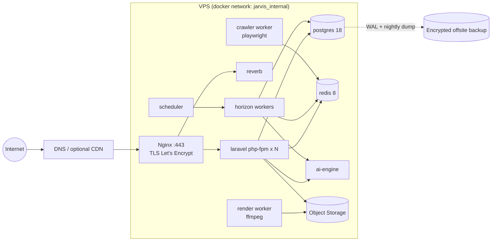

# JARVIS ONE — Deployment Guide

**Version:** 0.1 (Phase 0) · **Status:** পরিকল্পনা। আসল স্ক্রিপ্ট ও যাচাই ফেজ ২৯-এ; প্রতিটা ফেজে নতুন সার্ভিস/env যোগ হলে এখানে নোট।

---

## 1. Supported Deployment Modes

| মোড | কখন | কাঠামো |
|---|---|---|
| Local development | সবসময় | docker-compose (ENVIRONMENT_SETUP দেখুন) |
| Single-server production | লঞ্চ ও প্রথম পর্যায় | একটা VPS-এ docker-compose.prod (সব সার্ভিস) |
| Scalable cloud | ব্যবহার বাড়লে | আলাদা DB সার্ভার/managed PostgreSQL, managed Redis, একাধিক app ও worker নোড, load balancer |
| Enterprise private | Enterprise কাস্টমার | কাস্টমারের নিজের সার্ভারে আলাদা instance, নিজস্ব key |

**সাপোর্টেড নয়:** cPanel/shared hosting (ADR-011)। কারণ PostgreSQL+pgvector, Redis, দীর্ঘক্ষণ চলা queue worker, WebSocket, Python সার্ভিস, Playwright আর FFmpeg লাগে।

## 2. Server Requirements (single-server)

| | ন্যূনতম | প্রস্তাবিত |
|---|---|---|
| CPU | 4 vCPU | 8 vCPU |
| RAM | 8 GB | 16 GB |
| Disk | 160 GB NVMe | 320 GB NVMe + আলাদা ব্যাকআপ স্টোরেজ |
| OS | Ubuntu 24.04 LTS | |
| নেটওয়ার্ক | পাবলিক IPv4, ডোমেইন, DNS অ্যাক্সেস | |

ভিডিও রেন্ডার আর Playwright ক্রলিং চাপ দিলে প্রথমে আলাদা worker VPS যোগ করুন।

## 3. Production Topology

- শুধু 80/443 (আর SSH, key-only, নির্দিষ্ট পোর্ট) পাবলিক; PostgreSQL, Redis, ai-engine কখনো পাবলিক নয়।
- `/internal/*` path Nginx-এ পাবলিকের জন্য ব্লক।

## 4. Deployment Process (ফেজ ২৯-এ স্ক্রিপ্ট)

1. `infrastructure/scripts/server-setup.sh`: Docker, firewall (ufw), fail2ban, swap, unattended security updates, deploy ইউজার।
2. `.env.production` সার্ভারে আলাদাভাবে (secret manager বা হাতে), রিপোতে নয়।
3. `deploy.sh`: নতুন image build/pull → `php artisan down --render` (শুধু breaking migration হলে) → `migrate --force` → config/route/view cache → `horizon:terminate` → health check → up।
4. Zero-downtime লক্ষ্য: backward-compatible migration (expand → migrate → contract)।
5. `rollback.sh`: আগের image tag + DB restore point (শুধু প্রয়োজনে)।
6. প্রতিটা deploy-এর পর smoke test।

## 5. Backups

- PostgreSQL: দৈনিক এনক্রিপ্টেড dump + অবিরাম WAL archive (point-in-time recovery)।
- Object storage: versioning চালু, অফসাইট রেপ্লিকেশন।
- রিটেনশন: ৭ দৈনিক, ৪ সাপ্তাহিক, ১২ মাসিক।
- মাসিক restore drill, ফলাফল `BACKUP_RESTORE.md`-তে লগ।

## 6. Monitoring

- Health: `/up` (Laravel), `/internal/v1/health` (ai-engine), Horizon dashboard (admin-only)।
- Error tracking (Sentry বা self-hosted সমমান), uptime monitor, disk/CPU/RAM অ্যালার্ট।
- Provider health ও queue backlog admin ড্যাশবোর্ডে।
- লগ: JSON structured, logrotate, রিটেনশন নীতি অনুযায়ী।

## 7. Pre-Production Checklist (সারাংশ; পূর্ণ তালিকা ফেজ ২৯-এর `PRODUCTION_CHECKLIST.md`)

- [ ] `APP_DEBUG=false`, `APP_ENV=production`
- [ ] `APP_KEY`, `VAULT_KEY`, internal secret আলাদা ও শক্তিশালী
- [ ] HTTPS + HSTS, security headers
- [ ] Payment gateway live mode, webhook URL যাচাই
- [ ] Backup চালু ও restore টেস্ট সফল
- [ ] Admin অ্যাকাউন্টে 2FA
- [ ] Dev seeder ব্লকড
- [ ] Rate limit ও queue worker সংখ্যা ঠিক
- [ ] লিগ্যাল পেজ পেশাদার দিয়ে যাচাই

## 8. Related Documents (ফেজ ২৯-এ তৈরি হবে)

`SERVER_SETUP.md`, `PRODUCTION_CHECKLIST.md`, `BACKUP_RESTORE.md`, `INCIDENT_RESPONSE.md`
