# JARVIS ONE — Project Plan

**Version:** 0.1 (Phase 0) · **Method:** Phase-by-phase, approval-gated · **Phases:** 31 (০–৩০) + সাব-ফেজ (১৯.২, ২২.১–২২.২, ২৪.১–২৪.৩, ২৫.২, ২৭.২), ৯টা পর্ব, লঞ্চের পরে ঐচ্ছিক কাজ

চিহ্ন: ☐ বাকি · ◐ চলছে · ☑ সম্পন্ন · 🔑 বাইরের credential লাগবে · ✅ মাইলফলক

---

## Roadmap

প্রতিটা তীর একটা অনুমোদন গেট। সোর্স: [`docs/diagrams/12-phase-roadmap.mmd`](docs/diagrams/12-phase-roadmap.mmd)।

```mermaid
flowchart LR
    subgraph A["A · Foundation"]
        P0[0 Docs] --> P1[1 Dev env] --> P2[2 Auth + tenancy] --> P3[3 Super Admin]
    end
    subgraph B["B · AI Core"]
        P4[4 Providers] --> P5[5 Credits] --> P6[6 AI engine + chat] --> P7[7 Telegram]
    end
    subgraph C["C · First revenue"]
        P8[8 Lead extractor] --> P9[9 Proposal + email] --> P10[10 Payments] --> P11[11 Mobile v1]
    end
    subgraph D["D · E-commerce"]
        P12[12 Stores] --> P13[13 Inbox] --> P14[14 Sales + delivery]
    end
    subgraph E["E · Finance"]
        P15[15 Accounting] --> P16[16 Bill scan + bank] --> P17[17 VAT + tax] --> P18[18 Audit + payroll]
    end
    subgraph F["F · Intelligence"]
        P19[19 Memory + RAG] --> P192[19.2 Productivity] --> P20[20 Voice] --> P21[21 Agents + workflows]
    end
    subgraph G["G · Marketing"]
        P22[22 Creative studio] --> P23[23 Social + 23.2 Video Growth Agent] --> P24[24 Meta + Google Ads + SEO]
    end
    subgraph H["H · Desktop"]
        P25[25 Desktop + avatar] --> P26[26 Computer control]
    end
    subgraph I["I · Launch"]
        P27[27 White-label + dev platform] --> P28[28 Security + tests] --> P29[29 Production] --> P30[30 Launch]
    end
    P3 --> P4
    P7 --> M1{{Milestone 1<br/>working AI platform}}
    M1 --> P8
    P9 --> M2{{Milestone 2<br/>owner finds clients}}
    P11 --> M3{{Milestone 3<br/>sellable MVP}}
    M3 --> P12
    P14 --> M4{{Milestone 4}}
    M4 --> P15
    P18 --> M5{{Milestone 5}}
    M5 --> P19
    P21 --> P22
    P24 --> M6{{Milestone 6}}
    M6 --> P25
    P26 --> P27
    P30 --> M7{{Milestone 7<br/>commercial launch}}
```

---

## Global Phase Rules

**প্রতিটা ফেজ শুরুর আগে:** বিদ্যমান কোড ও `PROJECT_HANDOVER.md` পড়া → লক্ষ্য → ফাইল তালিকা → DB, API, UI পরিবর্তন → নিরাপত্তা ঝুঁকি → credential প্রয়োজন → acceptance criteria।

**প্রতিটা ফেজ শেষে:** সোর্স কোড, মাইগ্রেশন, সিডার, ফ্যাক্টরি, API, Blade পেজ, Livewire কম্পোনেন্ট, permission, অটোমেটেড টেস্ট, আসল টেস্ট রিপোর্ট, আপডেটেড `DEVELOPMENT_STATUS.md` / `CHANGELOG.md` / `PROJECT_HANDOVER.md`, env পরিবর্তন, ডিপ্লয় নোট, জানা সমস্যা, বাকি কাজ, credential তালিকা, git commit, আর **secret-মুক্ত সম্পূর্ণ ZIP**।

**তারপর থামা**, owner-এর অনুমোদনের পর পরের ফেজ। বড় ফেজ sub-phase-এ ভাগ হতে পারে (যেমন ৩a, ৩b)।

---

## পর্ব A — Foundation

### ☑ Phase 0: Planning & Documentation
- **লক্ষ্য:** implementation-ready আর্কিটেকচার ও ডকুমেন্টেশন।
- **ডেলিভারেবল:** README, PROJECT_PLAN, ARCHITECTURE, DATABASE_SCHEMA, API_DOCUMENTATION, SECURITY, ENVIRONMENT_SETUP, DEPLOYMENT_GUIDE, TESTING_GUIDE, DEVELOPMENT_STATUS, CHANGELOG, PROJECT_HANDOVER; ১০টা ডায়াগ্রাম; প্রযুক্তি সিদ্ধান্ত; ঝুঁকি ও নির্ভরতা; ফেজ ১ পরিকল্পনা।
- **Acceptance:** ডকুমেন্টগুলো পরস্পর সামঞ্জস্যপূর্ণ; owner অনুমোদন।

### ☐ Phase 1: Dev Environment & Project Structure
- **লক্ষ্য:** monorepo কঙ্কাল আর চলমান ডেভেলপমেন্ট পরিবেশ।
- **কাজ:**
  - Monorepo ফোল্ডার কাঠামো (ARCHITECTURE §4.1)
  - `apps/laravel`: Laravel 13, PHP 8.4, Livewire 4, Tailwind 4, Pest, Horizon, Reverb, Sanctum, Fortify, spatie/permission ইনস্টল ও কনফিগ; PostgreSQL ড্রাইভার
  - ডোমেইন module কঙ্কাল (`app/Domain/*`), base layout (admin/customer/public), JARVIS ডিজাইন টোকেন (ডার্ক নেভি, সায়ান), মূল Blade কম্পোনেন্ট লাইব্রেরির প্রথম সেট (button, card, input, table, modal, badge, empty/loading/error state)
  - `apps/ai-engine`: FastAPI কঙ্কাল, `/health`, settings, HMAC verify middleware, pytest
  - `apps/desktop`, `apps/mobile`: শুধু README placeholder (ফেজ ২৫ ও ১১-এ init)
  - `docker-compose.yml`: nginx, laravel (php-fpm), queue (horizon), reverb, scheduler, postgres 18 + pgvector, redis 8, ai-engine, mailpit
  - `.env.example` (সব সার্ভিস), `Makefile`/স্ক্রিপ্ট (`make up`, `make test`)
  - CI (GitHub Actions): PHP lint (Pint), PHPStan/Larastan, Pest, Python ruff + pytest, secret scan
  - Health endpoint: Laravel `/up` + DB/Redis/AI-engine চেক
  - Development seeder (শুধু ডেভ ডেটা, স্পষ্ট চিহ্নিত)
- **Acceptance:** লোকালে `make up` দিয়ে সব সার্ভিস ওঠে; Laravel ও Python টেস্ট পাস; CI সবুজ; Laravel → Python signed health call কাজ করে।
- **Credential:** নেই।

### ☑ Phase 2: Authentication & Multi-Tenancy (কোড; Laravel স্তর আপনার মেশিনে যাচাই বাকি)
- লগইন, রেজিস্টার, ইমেইল ভেরিফাই, পাসওয়ার্ড রিসেট, 2FA, ইনভাইটেশন গ্রহণ (Blade/Livewire + Fortify)
- ব্যক্তিগত workspace স্বয়ংক্রিয়, প্রতিষ্ঠান তৈরি/যোগদান/পরিবর্তন, সদস্য ইনভাইট, রোল
- সেশন ও ডিভাইস ম্যানেজমেন্ট, Sanctum API token (`/api/v1/auth`)
- Tenancy layer: middleware, `BelongsToTenant`, RLS মাইগ্রেশন ও `SET LOCAL`, queue context
- Platform ও tenant রোল/permission seed
- **Acceptance:** isolation test suite (read/update/delete/list/API/queue) পাস; 2FA ফ্লো টেস্ট; rate limit টেস্ট।

### ☑ Phase 3: Super Admin Panel Core (কোড; Laravel স্তর আপনার মেশিনে যাচাই বাকি)
- Admin layout (sidebar, header, breadcrumb, command search), আসল-ডাটা ড্যাশবোর্ড উইজেট
- ইউজার, tenant, রোল, permission matrix, plan ও feature (limit সহ), feature flags, system settings, branding (system), maintenance mode, audit log viewer
- **Acceptance:** admin সব CRUD করতে পারে; প্রতিটা sensitive action অডিট হয়; non-admin `/admin` এ 403।
- সম্ভাব্য sub-phase: 3a (layout, users, tenants, roles) · 3b (plans, features, settings, audit)

---

## পর্ব B — AI Core Engine

### ☑ Phase 4: AI Provider & Model Manager 🔑
- Admin: provider CRUD, credential vault, model, capability, pricing, access rule, routing rule, fallback, connection test, health dashboard
- Python adapters: OpenAI, Anthropic, Gemini, OpenRouter, Groq, Ollama, OpenAI-compatible
- Customer: available models, comparison, default, routing preference
- **Acceptance:** mock provider দিয়ে adapter টেস্ট; credential কখনো response/লগে নেই (টেস্ট); কমপক্ষে একটা আসল provider-এ connection test (key পেলে)।

### ✅ Phase 5: Credits & Usage Engine
- Wallet, append-only ledger, reserve/settle/release, idempotency, expiry, admin adjustment, packages, low-balance alert, spending limit, reconciliation job
- Customer usage চার্ট (model/agent/department), transaction history
- **Acceptance:** concurrency টেস্ট (একসাথে ১০০ রিকোয়েস্ট, ব্যালান্স সঠিক), duplicate idempotency টেস্ট, append-only trigger টেস্ট।

### ✅ Phase 6: Python AI Engine + Chat + Customer Dashboard v1 🔑
- FastAPI chat streaming, router, tool registry কঙ্কাল, internal auth, structured log
- Customer dashboard layout, overview, AI Assistant পেজ (স্ট্রিমিং, ইতিহাস, মডেল পরিবর্তন, সংযুক্তি, stop/regenerate/copy), profile
- Admin chat analytics, provider failure
- **Acceptance:** end-to-end চ্যাট (mock + আসল provider), ক্রেডিট সঠিক কাটে, অন্য tenant-এর conversation দেখা যায় না।

### ✅ Phase 7: Messaging Gateway + Telegram 🔑
- কেন্দ্রীয় gateway (inbound normalize, outbound, idempotency), Telegram bot, link code, টেক্সট/ছবি/ডকুমেন্ট/ভয়েস, approval বাটন, unlink; admin bot config, health, logs
- **Acceptance:** webhook signature টেস্ট, duplicate update টেস্ট, অচেনা ইউজার উপেক্ষা।

✅ **মাইলফলক ১:** কাজ করা AI প্ল্যাটফর্ম (web + Telegram)।

---

## পর্ব C — First Revenue

### ✅ Phase 8 (৮এ+৮বি সম্পন্ন; শুধু AI সারাংশ বাকি): Website Lead Extractor + CRM v1
- URL/CSV research job, Playwright crawler (robots.txt, rate limit, SSRF guard), contact extraction (libphonenumber, BD +880), AI site analysis ও service gap, লিড স্কোর, email syntax/MX চেক, duplicate বাদ
- CRM: pipeline board, লিড, কোম্পানি, কন্টাক্ট, নোট, টাস্ক, ট্যাগ, ফলো-আপ, CSV import/export
- **Acceptance:** fixture ওয়েবসাইটে extraction টেস্ট, SSRF টেস্ট, duplicate টেস্ট।

### ☑ Phase 9 (৯এ–৯সি + WhatsApp বোতাম, IMAP, প্রস্তাব সংযুক্তি কোড সম্পন্ন — আসল Gmail/Outlook/IMAP সার্ভারে যাচাই বাকি): Portfolio + Proposal + Email Outreach 🔑
- পোর্টফোলিও লাইব্রেরি, Brand Kit, প্রপোজাল টেমপ্লেট ও এডিটর, PDF (বাংলা ফন্ট সাপোর্টসহ), DOCX
- Gmail API, Microsoft Graph, SMTP; ক্যাম্পেইন, approval queue, দৈনিক সীমা, warm-up, SPF/DKIM/DMARC চেকার, unsubscribe, suppression, ফলো-আপ, reply/bounce ট্র্যাকিং, WhatsApp click-to-chat বাটন
- **Acceptance:** suppression টেস্ট, approval ছাড়া পাঠানো যায় না টেস্ট, বাংলা PDF রেন্ডার টেস্ট।

✅ **মাইলফলক ২:** owner নিজে ক্লায়েন্ট খোঁজা শুরু করতে পারবেন।

### ☑ Phase 10: Payment & Subscription 🔑 (কোড সম্পূর্ণ; sandbox end-to-end আপনার কী দিয়ে বাকি)
- **(আয়ের ক্ষেত্র ১৮: AI SaaS Business)** JARVIS ONE নিজেই মাসিক/বার্ষিক প্ল্যানে বিক্রির ভিত্তি; বাংলাদেশি গ্রাহকের জন্য টাকায় বিল ও ভ্যাট ইনভয়েস
- SSLCommerz, bKash, Nagad, Stripe adapter; checkout, IPN/webhook, server-side verify, invoice, upgrade/downgrade/cancel, grace period, coupon, ক্রেডিট প্যাকেজ, রিফান্ড রেকর্ড; admin billing analytics
- **Acceptance:** নকল redirect টেস্ট, amount mismatch টেস্ট, duplicate IPN টেস্ট, sandbox end-to-end।

### ☑ Phase 11: Mobile App v1 🔑 (কোড সম্পূর্ণ; ফোন/FCM/EAS আপনার দিকে বাকি)
- Expo প্রজেক্ট, লগইন, ড্যাশবোর্ড, চ্যাট, এজেন্ট, ওয়ার্কফ্লো মনিটর, Approval Inbox, নোটিফিকেশন, ইউজেস, প্রোফাইল, সেটিং; push (FCM), PIN/biometric step-up, emergency stop, admin health view
- **Acceptance:** API client টেস্ট, approval step-up টেস্ট, Android APK বিল্ড কনফিগ (EAS)।

✅ **মাইলফলক ৩:** বিক্রিযোগ্য MVP।

---

## পর্ব D — E-commerce Department

### ☑ Phase 12: Store Connectors + Product Manager 🔑 (১২এ দেশি ক্যাটালগ ☑; ১২বি WooCommerce/Shopify ☑ (কোড; আসল দোকানে অযাচাইকৃত); ১২সি JARVIS Connector প্যাকেজ ☑ (কোড; আসল Laravel শপে অযাচাইকৃত))
- WooCommerce, Shopify, JARVIS Connector (Laravel প্যাকেজ), native catalog; AI বিবরণ/ছবি, বাল্ক ইমপোর্ট, ভ্যারিয়েন্ট, স্টক, Draft → Approval → Publish

### ☑ Phase 13: Unified Inbox + Support Agent 🔑 (১৩এ ☑; ১৩বি ☑; ১৩সি AI সাপোর্ট এজেন্ট ☑ (কোড; আসল LLM/প্ল্যাটফর্মে অযাচাইকৃত); কমেন্ট-রিপ্লাই ☑ — ২৩.২সি-তে করা)
- Messenger, Instagram DM, WhatsApp Cloud API, Telegram, ওয়েব চ্যাট উইজেট, কমেন্ট রিপ্লাই; আসল স্টোর ডাটা থেকে উত্তর, বাংলিশ, হস্তান্তর, ২৪ ঘণ্টা উইন্ডো নিয়ম

### ☑ Phase 14: Sales Agent + Orders + Delivery 🔑 (১৪এ অর্ডার কোর ☑ (কোড); ১৪বি চ্যাটে অর্ডার ☑ (কোড; আসল LLM-এ অযাচাইকৃত); ১৪সি কুরিয়ার + দৈনিক রিপোর্ট ☑ (কোড; আসল কুরিয়ার API-তে অযাচাইকৃত))
- সাজেশন, আপসেল, চ্যাটে অর্ডার, ছাড়ের সীমা, COD কনফার্মেশন, ফেক অর্ডার স্কোর, Steadfast/Pathao/RedX, দৈনিক রিপোর্ট

✅ **মাইলফলক ৪:** সম্পূর্ণ AI E-commerce Manager।

---

## পর্ব E — Finance Department

### ☑ Phase 15: Accounting Engine (১৫এ কোর ☑ (কোড); ১৫বি ইনভয়েস/বিল/খরচ/AR/AP/ক্যাশবুক ☑ (কোড); ১৫সি P&L/ব্যালান্স শিট/ক্যাশ ফ্লো ☑ (কোড))
- COA টেমপ্লেট (BD), জার্নাল, লেজার, ক্যাশ/ব্যাংকবুক, ইনভয়েস, বিল, খরচ, AR/AP, period lock, ট্রায়াল ব্যালান্স, P&L, ব্যালান্স শিট, ক্যাশ ফ্লো
- **Acceptance:** balance invariant টেস্ট (property-based), locked period টেস্ট, রিপোর্ট টোটাল টেস্ট।

### ☑ Phase 16: AI Bill Scan + Banking + Auto Entry (১৬এ স্টেটমেন্ট ইমপোর্ট ও রিকনসিলিয়েশন ☑ (কোড); ১৬বি স্থায়ী সম্পদ/অবচয়/ইনভেন্টরি মূল্যায়ন ☑ (কোড); ১৬সি auto-posting ☑ (কোড); ১৬ডি AI বিল-স্ক্যান ☑ (কোড))
- OCR → খসড়া জার্নাল, ব্যাংক/bKash/Nagad স্টেটমেন্ট ইমপোর্ট, রিকনসিলিয়েশন, স্থায়ী সম্পদ ও অবচয়, ইনভেন্টরি মূল্যায়ন, e-commerce/ads/payment auto-posting

### ☑ Phase 17 (কোড; বাস্তব-পরীক্ষা বাকি): VAT & Tax (১৭এ সেটিং/হার/ক্রয়-বিক্রয় বই/রিটার্ন খসড়া ☑ (কোড); ১৭বি VDS/TDS/AIT ☑ (কোড); ১৭সি ক্যালেন্ডার ☑ (কোড))
- মূসক ফরম (চালানপত্র, ক্রয়/বিক্রয় হিসাব পুস্তক, মাসিক রিটার্ন খসড়া), VDS, ITC, TDS, AIT, ট্যাক্স ক্যালেন্ডার, effective-dated হার; NBR-এর বর্তমান নিয়ম যাচাই ও পেশাদার রিভিউ

### ☑ Phase 18 (কোড; বাস্তব-পরীক্ষা বাকি): Auditor + Payroll + Financial Analyst (১৮এ অডিটর ☑ (কোড); ১৮বি পে-রোল কাঠামো/রান ☑ (কোড); ১৮সি পে-স্লিপ/বেতন ফাইল ☑ (কোড); ১৮ডি বিশ্লেষক ☑ (কোড))
- অস্বাভাবিক/ডুপ্লিকেট লেনদেন, অডিট চেকলিস্ট, অডিটর অ্যাক্সেস, পে-রোল (কাঠামো, বোনাস, কর্তন, পে-স্লিপ, বেতন ফাইল), বাংলা ব্যাখ্যা, পূর্বাভাস (estimate চিহ্নিত)

✅ **মাইলফলক ৫:** সম্পূর্ণ AI Finance বিভাগ।

---

## পর্ব F — Intelligence & Agents

### ☑ Phase 19: Memory + RAG + Vision
- ১৯এ মেমোরি সেন্টার ☑ (কোড) · ১৯বি নলেজ বেস ☑ (কোড) · ১৯সি সোর্সসহ উত্তর ☑ (কোড) · ১৯ডি OCR/ভিশন ☑ (কোড)
- ক্যামেরা ইনপুট, Face Authentication ও স্ক্রিন-বোঝা ডেস্কটপ/মোবাইল ফেজে (২৫–২৬) সরানো হয়েছে
- মেমোরি সেন্টার, নলেজ বেস, ডকুমেন্ট প্রসেসিং, সোর্সসহ উত্তর, OCR, ছবি ও স্ক্রিন বোঝা
- ঐচ্ছিক: ক্যামেরা ইনপুট ও Face Authentication, শুধু ডিভাইসে লোকাল প্রসেসিং আর ইউজারের স্পষ্ট সম্মতিতে
### ☑ Phase 19.2: Productivity Suite + Communication 🔑
- ১৯.২এ টাস্ক/রিমাইন্ডার/নোট/দৈনিক পরিকল্পনা ☑ (কোড) · ১৯.২বি ডক/শিট/স্লাইড তৈরি ☑ (কোড) · ১৯.২সি মিটিং সারাংশ (লেখা থেকে) ও ইমেইল সারাংশ/খসড়া ☑ (কোড) · ১৯.২ডি শুধু-পড়ার ICS ক্যালেন্ডার, Slack/Discord ওয়েবহুক, অডিও→মিনিটস ☑ (কোড) · ১৯.২ই Google/Outlook OAuth ক্যালেন্ডার (পড়া + ইভেন্ট যোগ, অনুমোদনসহ) ☑ (কোড) · বাকি (ঐচ্ছিক, পরে): ইভেন্ট বদল/মোছা, টাস্ক↔ইভেন্ট স্বয়ংক্রিয় সিঙ্ক ☐
- Google ও Microsoft ক্যালেন্ডার, রিমাইন্ডার, টাস্ক ম্যানেজার, দৈনিক পরিকল্পনা
- মিটিং ট্রান্সক্রিপশন ও সারাংশ, নোট, ইমেইল সারাংশ ও লেখা
- ডকুমেন্ট, প্রেজেন্টেশন, স্প্রেডশিট তৈরি (ফাইল এক্সপোর্টসহ)
- Slack ও Discord ইন্টিগ্রেশন
### ◐ Phase 20: Voice Assistant 🔑
- ওয়েব ভয়েস (মাইক→লেখা→উত্তর→কণ্ঠ, ক্রেডিটসহ) ☑ (কোড) · ভয়েস থেকে ওয়ার্কফ্লো চালানো ☑ (কোড) · বাকি (আসল ডিভাইস লাগে): ওয়েক-ওয়ার্ড, মোবাইল অ্যাপে মাইক, রিয়েল-টাইম স্ট্রিমিং ☐
### ◐ Phase 21: Agent Engine + Visual Workflow Builder
- কম্পিউটার এজেন্ট ☑ (০.১০৩.০, `apps/pc-agent`: পিসি/ল্যাপটপ/VPS-এ চলে; GUI/Tauri ও ব্রাউজার এজেন্ট বাকি)।
- ২৬ বাকি ☑ (কোড, ০.৯৯.০): উচ্চ-ঝুঁকির পিসি-কাজ শুধু মোবাইল+পিনে অনুমোদন (API + DB নিয়ম)। বাকি: (মোবাইল স্ক্রিন ও হ্যান্ডঅফ ☑ ০.১০০.০) , হ্যান্ডঅফ UI, আসল এজেন্ট।
- ২১ বাকি ☑ (কোড, ০.৯৮.০): `parallel` ধাপ (শাখাগুলো ক্রমে চলে), `webhook.send` + `workflow.message` ইভেন্ট, `pc.read_file/list_dir/write_file/result` টুল, ২টি নতুন টেমপ্লেট। বাকি: ভিজ্যুয়াল ক্যানভা (ব্রাউজারে যাচাই লাগবে)।
- ২১এ ইঞ্জিন ভিত্তি ☑ (কোড): টুল রেজিস্ট্রি/ঝুঁকি, ৫ ধরনের ধাপ, ৫ টেমপ্লেট, লগ, বাজেট, অনুমোদন, দৈনিক সময়সূচি · ২১বি delay ধাপ ও লাইন-ধরে-চালানো (`each`) ☑ (কোড) · Coding Assistant ওয়েব চ্যাট মোড ☑ (কোড; ২১ক) · বাকি: ভিজ্যুয়াল ক্যানভাস (ব্রাউজারে যাচাই লাগে), প্যারালাল, বাইরে-পাঠানো টুল, ফাইলে-কাজ করা Coding Agent (ডেস্কটপ) ☐
- এজেন্ট টেমপ্লেট (৬টা বিভাগ: Personal, Sales, Marketing, E-commerce, Finance, **Developer**), টুল রেজিস্ট্রি ও risk class, Livewire + Alpine ক্যানভাস, নোড (trigger, AI, tool, condition, branch, loop, delay, schedule, approval, notification, output), version, retry, timeout, budget
- **Coding Assistant ও Coding Agent**: কোড লেখা, ব্যাখ্যা, bug fix, প্রজেক্ট বিশ্লেষণ (ওয়েবে চ্যাট মোড; ফাইলে কাজ ডেস্কটপে, ফেজ ২৫–২৬)

---

## পর্ব G — Marketing Department

### ✅ Phase 22.1: Image Studio 🔑 (কোড সম্পন্ন; আসল ইমেজ-মডেল যাচাই বাকি)
- ✅ ২২.১c সম্পন্ন: ডিজাইন সম্পাদনা + ১০টি ভার্সন + ফেরানো + ৬টি টেমপ্লেট। ✅ ২২.১d: ক্লায়েন্ট উত্তর দিলে ডিজাইনারের নোটিফিকেশন। ✅ ২২.১e: লোগো আইডিয়া (খসড়া)।
- ২২.১ ডিজাইন স্টুডিও ☑ (কোড): ৫ সাইজ, বাংলা টেক্সট ওভারলে, ব্র্যান্ড কিট, AI/আপলোড/গ্রেডিয়েন্ট ব্যাকগ্রাউন্ড, ক্লায়েন্ট অনুমোদন লিংক · বাকি: সম্পাদনা/ভার্সন, টেমপ্লেট লাইব্রেরি, লোগো জেনারেশন, নোটিফিকেশন ☐
- **(যোগ — আয়ের ক্ষেত্র ২: AI Graphic Design)** লোগো, ব্যানার, পোস্টার, Facebook/Instagram পোস্ট ও বিজ্ঞাপনের ক্রিয়েটিভ; ব্র্যান্ড কিটের রং/লোগো/টোন অটো ব্যবহার (ফেজ ৯এ); মাল্টি-সাইজ এক্সপোর্ট (পোস্ট, স্টোরি, কভার, অ্যাড); বাংলা টেক্সট সঠিকভাবে বসানো (টেক্সট ছবির বদলে ফন্ট দিয়ে ওভারলে); ক্লায়েন্টকে ডিজাইন পাঠিয়ে অনুমোদন নেওয়া
### ✅ Phase 22.2: Video Studio & Video Editor 🔑
- ✅ ২২.২a সম্পন্ন: স্লাইড-ভিডিও, FFmpeg রেন্ডার কিউ, ভয়েস-ওভার, মাল্টি-সাইজ। ✅ ২২.২b সম্পন্ন: সাবটাইটেল, AI স্ক্রিপ্ট। ✅ ২২.২c-ক সম্পন্ন: ক্লিপ এডিটর (ছাঁটা, নীরবতা কাটা, সাইজে ক্রপ)। ✅ ২২.২c-খ সম্পন্ন: ব্যাকগ্রাউন্ড মিউজিক (নিজেদের সিনথেসাইজ করা)। ✅ ২২.২c-গ সম্পন্ন: টাইমলাইন, দৃশ্যে AI ছবি। বাদ/পরে: পুরো AI ভিডিও জেনারেশন — প্রোভাইডার কী থাকলে ( জেনারেশন, টাইমলাইন এডিটর, রয়্যালটি-ফ্রি মিউজিক)
- AI ভিডিও জেনারেশন, টাইমলাইন এডিটর, অটো সাবটাইটেল, নীরবতা কাটা, ক্লিপ বানানো, ভয়েস-ওভার, মাল্টি-সাইজ, FFmpeg রেন্ডার কিউ, রয়্যালটি-ফ্রি মিউজিক
### ✅ Phase 23: Social Media Manager 🔑 (কোড সম্পন্ন, আসল Facebook যাচাই বাকি)
- ✅ ২৩a সম্পন্ন: কন্টেন্ট প্ল্যানার (ক্যালেন্ডার, ড্রাফট, AI ক্যাপশন, মিডিয়া বাছা, অনুমোদন, "পোস্ট হয়েছে" ট্র্যাকিং)। ✅ ২৩b কোড সম্পন্ন (ফেক-HTTP টেস্টে): Facebook Page অটো-পোস্ট — ❗ আসল টোকেনে যাচাই বাকি। ✅ ২৩c কোড সম্পন্ন: পোস্ট ইনসাইট (রিঅ্যাকশন/কমেন্ট/শেয়ার/রিচ) — ❗ আসল Facebook-এ যাচাই বাকি।
### ✅ Phase 23.2: AI Social Media Manager & Growth Agent (Video Creator Agent) 🔑
- **স্কোপ (ব্যবহারকারীর সাথে ঠিক, ২০২৬-১১-০৪):** শুধু ড্রাফট, প্রতিটিতে অনুমোদন। ধাপ: ✅ a কন্টেন্ট-প্ল্যান এজেন্ট; ✅ b গ্রোথ বিশ্লেষণ (ইনসাইট থেকে পরামর্শ-রিপোর্ট); ✅ c কমেন্ট-রিপ্লাই (Facebook কমেন্ট API + অনুমতি; উত্তর খসড়া → অনুমোদনে); ✅ d YouTube (OAuth, লং ভিডিও, টাইটেল/থাম্বনেইল/SEO; আপলোড কোটা)।
- **(যোগ — ব্যবহারকারীর অনুরোধে, ২০২৬-১১-০৪)** আলাদা এজেন্ট: একটি বিষয় বা নির্দেশনা দিলে Facebook ও YouTube চ্যানেলের ডিজিটাল মার্কেটিংয়ের অনেক কাজ মানুষের মতো নিজে করবে। নির্ভর করে: ফেজ ২১ (Agent Engine), ২২.১ (Image Studio), ২২.২ (Video Studio), ২৩ (Social Media Manager), ৪ (প্রোভাইডার কী)।
- **১. AI নিজে ভিডিও তৈরি করবে (YouTube লং ভিডিওসহ):**
  - ভিডিওর বিষয় নির্বাচন (চ্যানেলের দর্শক/ট্রেন্ড/আগের ফলাফল দেখে)
  - স্ক্রিপ্ট লেখা
  - AI ভয়েস তৈরি (বাংলা/ইংরেজি/আরবি)
  - ছবি ও ভিডিও ক্লিপ সংগ্রহ বা তৈরি
  - ভিডিও এডিট (ফেজ ২২.২-এর টাইমলাইন ও FFmpeg রেন্ডার কিউ ব্যবহার করে)
  - বাংলা, ইংরেজি ও আরবি সাবটাইটেল যুক্ত করা
  - ব্যাকগ্রাউন্ড মিউজিক যুক্ত করা (শুধু রয়্যালটি-ফ্রি/লাইসেন্সপ্রাপ্ত)
  - YouTube-এর জন্য লং ভিডিও তৈরি (শর্ট/রিলস-এর পাশাপাশি)
- **নিরাপত্তা ও নিয়ম (সব এজেন্টের মতোই):** প্রকাশ/পোস্ট করার আগে মালিকের অনুমোদন (approval gate) ডিফল্ট; দৈনিক/মাসিক cap; ক্রেডিট reserve→settle; সব কাজের লগ; কপিরাইটযুক্ত ছবি/মিউজিক/ভিডিও নয়; আসল ব্যক্তির কণ্ঠ বা চেহারা অনুমতি ছাড়া নয়; প্ল্যাটফর্ম নীতি (YouTube/Facebook) মেনে চলা।
- **বিস্তারিত স্কোপ (যেমন কমেন্ট-রিপ্লাই, থাম্বনেইল/টাইটেল/SEO, পোস্টিং সময়সূচি, গ্রোথ বিশ্লেষণ) ফেজ শুরুর আগে ব্যবহারকারীর সাথে চূড়ান্ত করা হবে।**
### ✅ Phase 24.1: Meta Ads Manager 🔑
- **ধাপ (শুধু ড্রাফট + অনুমোদন; ক্যাম্পেইন সবসময় PAUSED তৈরি, বাজেট ক্যাপ):** ✅ a সংযোগ + শুধু-পড়া সিঙ্ক ও ড্যাশবোর্ড; ✅ b AI ক্যাম্পেইন ড্রাফট + খরচ-সীমা + অনুমোদন; ✅ c অনুমোদনের পর PAUSED তৈরি; ✅ d অপ্টিমাইজেশন পরামর্শ (pause/scale অনুমোদনে)।
### ✅ Phase 24.2: Google Ads Manager 🔑
- **ধাপ:** ✅ a সংযোগ (OAuth) + শুধু-পড়া সিঙ্ক ও ড্যাশবোর্ড; ✅ b Search ক্যাম্পেইন ড্রাফট + AI অ্যাড কপি/কীওয়ার্ড + খরচ-সীমা + অনুমোদন; ✅ c অনুমোদনের পর PAUSED তৈরি; ✅ d পরামর্শ (খরচ/কনভার্সন-ভিত্তিক) + অনুমোদিত বিরতি। **বাকি (পরে):** Search Terms থেকে নেগেটিভ কীওয়ার্ড, Quality Score, PMax/Display/Shopping/YouTube বিজ্ঞাপন, কীওয়ার্ড প্ল্যানার।
- MCC + Developer Token, Search/PMax/Display/YouTube/Shopping, কীওয়ার্ড প্ল্যানার, অ্যাড কপি, Search Terms, অফলাইন কনভার্শন, Quality Score, cap ও approval
### ☑ Phase 24.3: SEO + Marketing Manager Agent
- **ধাপ:** ✅ a ক্লায়েন্ট রিপোর্ট; ✅ b এজেন্সি মোড (ক্লায়েন্ট, ব্র্যান্ড, অ্যাকাউন্ট বাঁধা, ক্লায়েন্ট-রিপোর্ট); ✅ c SEO অডিট (নিয়মভিত্তিক, ক্রেডিট-মুক্ত); ✅ d Marketing Manager Agent (ওয়ার্কফ্লো-টুল `marketing.snapshot`/`seo.latest` + ৫ টেমপ্লেট; শুধু পরামর্শ)।
- ✅ **(২৪.৩a সম্পন্ন)** **(যোগ — আয়ের ক্ষেত্র ১: AI Digital Marketing Agency)** ক্লায়েন্ট রিপোর্ট জেনারেটর: মাসিক/সাপ্তাহিক কাজের ও ফলাফলের রিপোর্ট (Meta/Google Ads ও সোশ্যাল ডেটা থেকে), ব্র্যান্ড কিট সহ বাংলা/ইংরেজি PDF/DOCX — ফেজ ৯এ-র ডক-রেন্ডারার পুনর্ব্যবহার করে
- ✅ **(২৪.৩b সম্পন্ন)** **(যোগ)** একই ওয়ার্কস্পেসে একাধিক ক্লায়েন্ট ব্র্যান্ড/অ্যাকাউন্ট আলাদা রাখা (এজেন্সি মোড): ক্লায়েন্টভিত্তিক ব্র্যান্ড কিট, পোস্ট, বিজ্ঞাপন ও রিপোর্ট

✅ **মাইলফলক ৬:** সম্পূর্ণ AI Marketing বিভাগ।

---

## পর্ব H — Desktop

### ☐ Phase 25: Windows Desktop App 🔑 (code signing)
- **(আবার অন্তর্ভুক্ত — ব্যবহারকারীর অনুরোধে)** Tauri ডেস্কটপ অ্যাপ এখন স্কোপে; এই পরিবেশে কম্পাইল/সাইন করা যাবে না, কোড+বিল্ড স্ক্রিপ্ট দেওয়া হবে
- Tauri 2, ফিউচারিস্টিক UI ও ভিজুয়ালাইজার, চ্যাট, ভয়েস, লোকাল Ollama, লোকাল FFmpeg রেন্ডার, সাইনড আপডেট
- **লোকাল SQLite ডাটাবেস**: অফলাইন মেমোরি, লোকাল চ্যাট, টাস্ক কিউ, ফাইল ইনডেক্স, ক্লাউডের সাথে সিঙ্ক (Free প্ল্যানে অফলাইন ব্যবহার)
- Coding Assistant-এর লোকাল প্রজেক্ট ফোল্ডার মোড (অনুমোদিত ফোল্ডারে)
- পার্সোনালাইজেশন: থিম, উইজেট, হটকি, স্টার্টআপ সেটিং
### ◐ Phase 25.2: AI Character & Avatar (☑ কোড: চরিত্র, পার্সোনা, চ্যাট, ২D SVG অবতার, অভিব্যক্তি, অনুমানভিত্তিক লিপ-সিংক প্রিভিউ; ভয়েস আউটপুট + অডিও-ঘড়িতে সিঙ্ক ☑ (০.১০২.০); বাকি: ৩D, মোবাইল/ডেস্কটপে অবতার, মার্কেটপ্লেস)
- মৌলিক চরিত্র (পুরুষ, নারী, কাস্টম), 2D/3D অবতার, লিপ-সিংক, অভিব্যক্তি, পার্সোনালিটি, আবেগভিত্তিক উত্তর, চরিত্রের ভয়েস, চরিত্র মার্কেটপ্লেস
- কোনো বিদ্যমান সিনেমা বা কমিক চরিত্রের অনুকরণ নয় (ARCHITECTURE R14)
### ◐ Phase 26: Computer Control + Browser Agent (২৬ক ☑ নিয়ম/ডেটা-মডেল; ২৬খ ☑ API+ওয়েব পাতা (কোড); বাকি: আসল ডেস্কটপ/ব্রাউজার এজেন্ট, মোবাইল step-up/হ্যান্ডঅফ)
- allowlist, sandbox, scope, per-action approval, emergency stop, mobile → desktop handoff
- **System Monitor**: CPU, RAM, GPU, ডিস্ক, নেটওয়ার্ক, ব্যাটারি, তাপমাত্রা (সমর্থিত হার্ডওয়্যারে), পারফরম্যান্স অ্যালার্ট
- বাড়তি কন্ট্রোল: ভলিউম, ব্রাইটনেস, Wi-Fi/Bluetooth, শাটডাউন/রিস্টার্ট (ঝুঁকিপূর্ণগুলো অনুমোদনসহ)
- মোবাইল থেকে QR দিয়ে PC পেয়ারিং, PC-র অবস্থা দেখা

---

## পর্ব I — Enterprise & Launch

### ✅ Phase 27 (কোড): White-label + Reseller + Enterprise
- ✅ ২৭a (কোড): Reseller (কোড দিয়ে যুক্ত হওয়া, কমিশন-রিপোর্ট, পেআউট, অ্যাডমিন)। ✅ ২৭b (কোড): White-label (নাম, রং, সাপোর্ট ইমেইল, powered-by)। ✅ ২৭c (কোড): Enterprise লাইসেন্স (সিট-সীমা ট্রিগারে, মেয়াদ)। SSO/কাস্টম ডোমেইন এখনো নেই (ঐচ্ছিক, পরে)।
### ◐ Phase 27.2: Developer Platform + Plugin Marketplace
- ✅ ২৭.২a (কোড): পাবলিক API কী (হ্যাশ, স্কোপ, মেয়াদ, বাতিল), `/api/public/v1` (me, credits, workflows, run), ডেভেলপার পেজ। ✅ ২৭.২b (কোড): Webhooks (`run.finished`, সাইন, রিট্রাই, SSRF-সুরক্ষা)। ✅ ২৭.২c (কোড): ব্যবহার-অ্যানালিটিক্স, OpenAPI স্পেক, Python SDK। ✅ ২৭.২d (কোড): JS SDK, webhook বার্তা-তালিকা। ✅ ২৭.২e (কোড): প্লাগইন স্টোর (জমা, অ্যাডমিন রিভিউ, ইনস্টল/আপডেট)। ✅ ২৭.২f (কোড): MCP সার্ভার + dry-run। ✅ ২৭.২g (কোড): webhook-এ `run.waiting_approval`, `pc.action.pending` ও ইভেন্ট বাছাই।
- পাবলিক API key, ডেভেলপার ড্যাশবোর্ড, API ডকুমেন্টেশন পোর্টাল, webhooks, SDK, কাস্টম এজেন্ট API, MCP ইন্টিগ্রেশন, ডেভেলপার স্যান্ডবক্স, ইউজেস অ্যানালিটিক্স
- প্লাগইন স্টোর: ইনস্টল, আপডেট, রিমুভ, পারমিশন ম্যানিফেস্ট, ভার্সনিং, রিভিউ; অ্যাডমিন "Plugin Management" (রিভিউ ও অনুমোদন ছাড়া প্রকাশ নয়)
### ◐ Phase 28: Security Audit + Full Testing
### ◐ Phase 28.5: সেলফ-হোস্ট প্যাকেজ (ইউজারের নিজের VPS/কম্পিউটার) 🔑
- ইউজার নিজের VPS-এ Docker দিয়ে পুরো JARVIS চালাবে (ইনস্টলার, লাইসেন্স কী, আপডেট, ব্যাকআপ) + নিজের কম্পিউটারে লোকাল Ollama/FFmpeg ওয়ার্কার (ডেস্কটপ অ্যাপের সাথে) যা ক্লাউড সার্ভিসের কাজ হালকা করে
### ☐ Phase 29: Production Deployment 🔑 (VPS, domain)
### ☐ Phase 30: Commercial Launch

✅ **মাইলফলক ৭:** সম্পূর্ণ JARVIS ONE বাজারে।

### ☐ Post-launch (ঐচ্ছিক, ফেজ ৩১+)
- **AI Research Assistant (আয়ের ক্ষেত্র ২০)**: কোম্পানির জন্য বাজার গবেষণা, প্রতিযোগী বিশ্লেষণ, উৎস-সহ ওয়েব গবেষণা রিপোর্ট। ফেজ ১৯ (RAG), ২৪.৩ ও ৯এ-র রিপোর্ট কাঠামোর ওপর দাঁড়ায়; প্রতিটি দাবির পাশে উৎস লিংক বাধ্যতামূলক, উৎস ছাড়া তথ্য "অযাচাইকৃত" চিহ্নিত
- **AI Model Training / ডেটা লেবেলিং (আয়ের ক্ষেত্র ১৯)**: টাস্ক তালিকা, লেবেল/রেটিং ফর্ম, রিভিউয়ার, গুণমান যাচাই, কাজের হিসাব ও পেমেন্ট। মূল পণ্যের বাইরে — সিদ্ধান্ত না হওয়া পর্যন্ত শুধু তালিকাভুক্ত
- **World Monitor**: আবহাওয়া, খবর, ফ্লাইট/জাহাজ ট্র্যাকিং, ভূমিকম্প ও দুর্যোগ সতর্কতা, টাইমজোন; প্রতিটা ডাটা সোর্সের API ও লাইসেন্স যাচাইয়ের পর
- Laravel 14 আপগ্রেড (প্রকাশের পর)
- iOS অ্যাপ

---

## Cross-Cutting Additions (ফেজ ০-এ নথিভুক্ত)

| সংযোজন | কোন ফেজে |
|---|---|
| Mobile app মনিটরিং ও কন্ট্রোল | ১১ (+ প্রতিটা পরবর্তী মডিউলের মোবাইল ভিউ) |
| Telegram / WhatsApp অ্যাসিস্ট্যান্ট চ্যানেল | ৭, ১৩ |
| Website Lead Extractor + পোর্টফোলিও + অফার লেটার | ৮, ৯ |
| AI E-commerce Manager | ১২–১৪ |
| Accounting / VAT / Audit Assistant | ১৫–১৮ |
| Google Ads Manager | ২৪.২ |
| Video Editor | ২২.২, ২৫ (লোকাল রেন্ডার) |
| Productivity Suite, Slack, Discord, ক্যালেন্ডার | ১৯.২ |
| Coding Assistant ও Coding Agent | ২১, ২৫ |
| লোকাল SQLite ও অফলাইন সিঙ্ক | ২৫ |
| AI Character & Avatar | ২৫.২ |
| System Monitor, বাড়তি কন্ট্রোল, QR পেয়ারিং | ২৬ |
| Developer Platform + Plugin Marketplace | ২৭.২ |
| ক্যামেরা ও Face Auth (ঐচ্ছিক, লোকাল) | ১৯ |
| World Monitor (ঐচ্ছিক) | লঞ্চের পরে |

## Recommended Early Applications (owner-এর কাজ, সময় লাগে)

| আবেদন | কখন শুরু করবেন |
|---|---|
| Meta Business Verification + App Review | ফেজ ৮–১০ চলাকালীন |
| WhatsApp Business নম্বর | ফেজ ১০-এর মধ্যে |
| Google Ads Developer Token (Basic Access) | ফেজ ১৫–২০ চলাকালীন |
| SSLCommerz / bKash / Nagad merchant | ফেজ ৫–৮ চলাকালীন |
| Windows code-signing সার্টিফিকেট | ফেজ ২১–২৪ চলাকালীন |
| প্রোডাক্টের নামের ট্রেডমার্ক যাচাই (আইনজীবী) | যত দ্রুত সম্ভব, অবশ্যই ফেজ ৩০-এর আগে |
